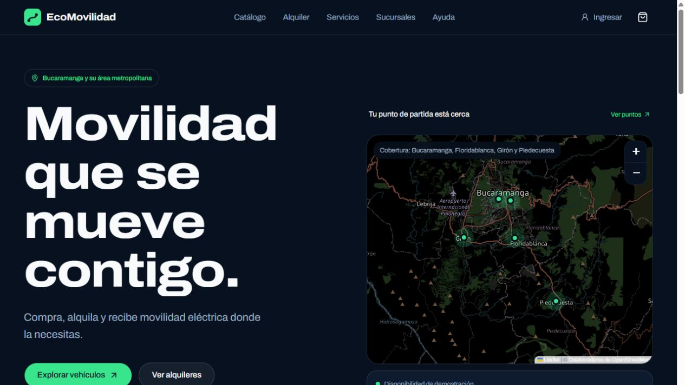
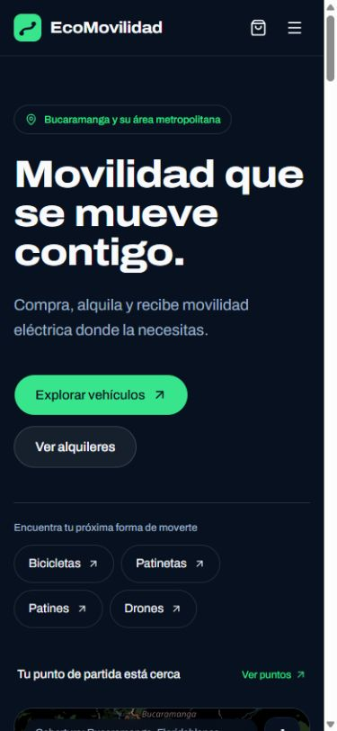
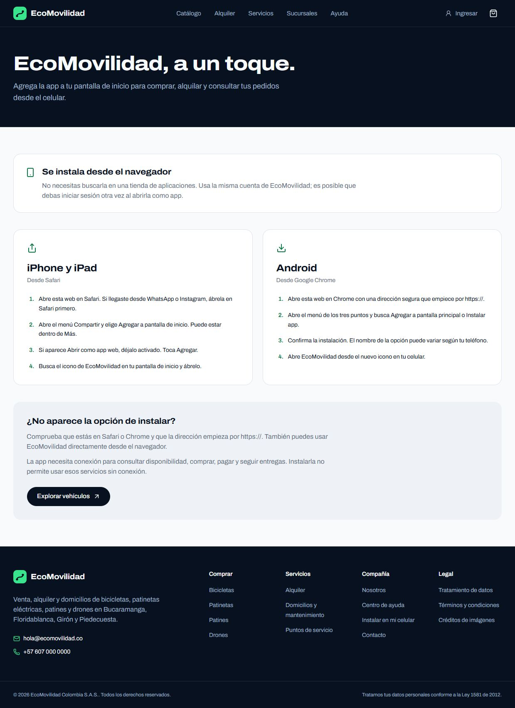

# EcoMovilidad

Tienda en línea, alquiler de flota, domicilios y panel de operación de **EcoMovilidad Colombia S.A.S.** para el área metropolitana de Bucaramanga (Bucaramanga, Floridablanca, Girón y Piedecuesta).

Los 15 casos de uso del proyecto están implementados. Aún no está publicado: usa datos de demostración, una pasarela de pagos de pruebas y un simulador de GPS. Abajo está [lo que falta para salir a producción](#lo-que-falta).

Esta versión con instalación móvil y atlas de diagramas está en la rama
`frontend/diagramas-ecomovilidad`. Si tu copia está en `main`, cambia a esa rama
antes de seguir la demostración de este README.

## Capturas

Portada de escritorio con mapa y datos de demostración:



La misma web en una pantalla de 390 píxeles de ancho:



<details>
<summary>Ver la página con los pasos de instalación para iPhone y Android</summary>



</details>

Capturas de la web tomadas el 16 de noviembre de 2026. La vista móvil usa un
viewport de navegador; no acredita una instalación en un dispositivo físico.

## Usarla en Android, iPhone y iPad

EcoMovilidad funciona desde el navegador del celular y está preparada como
**PWA instalable**: puede tener su propio icono y abrirse como una app. Para
esta demostración no hay que descargar un APK ni buscarla en App Store o
Google Play. Se instala desde la dirección web **HTTPS** de la demo.

### Android — Google Chrome

1. Abre en Chrome la URL HTTPS que te comparta quien maneja la PC de la demo.
2. Puedes recorrer el catálogo, registrarte o iniciar sesión y usar la web
   directamente. En el pie de página, **Instalar en mi celular** abre `/instalar`.
3. Para agregarla como app, abre el menú de los tres puntos de Chrome y elige
   **Agregar a pantalla principal** o **Instalar app**. El texto depende de la
   versión de Chrome y del teléfono.
4. Confirma y abre **EcoMovilidad** desde el nuevo icono del celular.

### iPhone y iPad — Safari

1. Abre la URL HTTPS de la demo en **Safari**. Si el enlace llegó por WhatsApp
   o Instagram, ábrelo en Safari en lugar de usar el navegador interno.
2. Abre **Compartir** y selecciona **Agregar a pantalla de inicio**; puede estar
   dentro de **Más**.
3. Si aparece **Abrir como app web**, déjalo activado y toca **Agregar**.
4. Abre EcoMovilidad desde el icono de la pantalla de inicio.

### Qué se puede hacer desde el celular

- Consultar catálogo, sucursales y disponibilidad.
- Registrarse e iniciar sesión con la misma cuenta de la web. Al abrir la app
  instalada puede ser necesario volver a iniciar sesión.
- Comprar con la pasarela de pruebas, reservar alquileres y consultar pedidos
  y facturas de venta. Los pagos de la demo no cobran dinero real.
- Seguir domicilios y confirmar **Recibí mi pedido** cuando corresponda una
  entrega con dron y ya esté registrada la liberación del paquete.
- Abrir `/admin` si la cuenta tiene permiso de administrador. Instalar la PWA
  no concede ese permiso ni crea un rol propio para domiciliarios.

**La app necesita conexión con el servidor.** Instalarla no copia FastAPI ni
PostgreSQL al teléfono y no permite comprar, pagar o consultar seguimiento
sin conexión. Si la PC se apaga, se suspende o se cierra el túnel, el icono
permanece instalado pero los servicios dejan de responder.

## Demo móvil desde una PC Windows

La PC ejecuta Next.js, FastAPI y PostgreSQL; los celulares acceden a la web
mediante una URL HTTPS temporal. Necesitas **Node.js, Docker Desktop con
contenedores Linux y cloudflared**. La PC y los celulares necesitan Internet
para el túnel. No hace falta contratar un servidor para esta demo.

Antes de los comandos siguientes, ejecutar `npm ci` y preparar `.env` y
`.env.local` con `API_MODE=real` y
`API_BASE_URL=http://127.0.0.1:8000/api/v1`. La
[guía completa para Windows](docs/DEMO_MOVIL_WINDOWS.md) incluye la generación
de la clave de PostgreSQL sin sobrescribir archivos existentes.

**Terminal 1 — obtener la dirección HTTPS y mantener el túnel abierto:**

```powershell
cloudflared tunnel --url http://127.0.0.1:3100
```

Copiar la URL `https://…trycloudflare.com` que aparezca. Mientras el servidor
no haya arrancado puede mostrar un error. Quien tenga esa URL podrá abrir la
demo; usar datos y cuentas de prueba.

**Terminal 2 — iniciar el backend y la web desde la raíz del repositorio:**

```powershell
$demoUrl = 'https://REEMPLAZAR.trycloudflare.com'
if ($demoUrl -match 'REEMPLAZAR') { throw 'Escribe la URL real del túnel.' }
$env:FRONTEND_URL = $demoUrl
$env:NEXT_PUBLIC_SITE_URL = $demoUrl
docker compose up -d --build --wait
# Si Docker falla, corregirlo antes de continuar.
npm run build
# Solo cuando el build termine correctamente:
npm run start -- --hostname 127.0.0.1 --port 3100
```

Compose aplica las migraciones, incluida la **0013**, al iniciar la API. Abrir
la URL HTTPS en el celular, seguir los pasos de Android o iPhone e iniciar
sesión. Para probar el panel, registrar primero una cuenta de prueba y
convertirla en administradora desde otra terminal:

```powershell
docker compose exec api python -m app.cli make-admin 'CORREO_REGISTRADO_DE_LA_DEMO'
```

La web es el único punto compartido: FastAPI y PostgreSQL permanecen en
`127.0.0.1`. **No abrir los puertos 8000 ni 5433 a los celulares.** En el
teléfono, `localhost` se refiere al teléfono, no a la PC.

Sin túnel se puede visitar la web por la IP de la PC desde la misma red Wi-Fi,
pero una IP privada con HTTP no equivale al contexto HTTPS necesario para
demostrar la instalación completa. La guía de Windows explica esa alternativa.

Para terminar, usar **Ctrl+C** en las terminales de la web y el túnel, y
`docker compose down` para detener el backend conservando los datos. La URL de
un túnel temporal cambia al reiniciarlo: una PWA instalada con la URL anterior
necesitará volver a agregarse. Un hostname estable evita esa reinstalación.

**Validación pendiente:** comprobar instalación y reapertura en un iPhone y un
Android físicos. Se han comprobado el manifiesto, los iconos, la página de
instalación y la presentación adaptable en navegador.

## Tecnologías

| Área | Tecnologías |
| --- | --- |
| Frontend (`src/`) | Next.js 16 (App Router), React 19, TypeScript, Tailwind CSS 4, shadcn/ui + Radix, TanStack Query, Zod |
| Mapas | Leaflet + OpenStreetMap; Google Maps opcional si se configura una llave |
| Backend (`backend/`) | Python 3.13, FastAPI, SQLAlchemy 2, Pydantic 2, Alembic, Argon2, fpdf2, segno; dependencias con uv |
| Base de datos | PostgreSQL 16 + PostGIS 3 |
| Pagos | Pasarela de pruebas para desarrollo; en producción, pago manual o Wompi |
| Pruebas y calidad | Vitest, Testing Library, ESLint, pytest, Ruff, GitHub Actions, gitleaks |
| Infraestructura | Docker Compose; Caddy para HTTPS en producción; demo temporal con Cloudflare Tunnel |

## Inicio rápido

Necesitas Docker (en macOS sirve Colima), Node.js 20.9 o superior y, para las pruebas del backend, [uv](https://docs.astral.sh/uv/).

```bash
# Solo la primera vez: crea las claves locales (archivos fuera de Git)
clave="$(openssl rand -hex 24)"
echo "POSTGRES_PASSWORD=$clave" > .env
sed "s/CAMBIAR/$clave/" backend/.env.example > backend/.env
printf 'API_MODE=real\nAPI_BASE_URL=http://127.0.0.1:8000/api/v1\n' > .env.local
npm install

# Cada vez
docker compose up -d --build         # PostgreSQL/PostGIS + API; aplica migraciones y datos de demostración
npm run dev                          # Tienda: http://localhost:3000   Panel: http://localhost:3000/admin
```

**Administrador:** regístrate en la tienda y ejecuta:

```bash
docker compose exec api python -m app.cli make-admin tu@correo.com
```

Detener: `docker compose down` (conserva los datos) o `docker compose down -v` (borra los datos).

Sin Docker, `npm run dev` sin `.env.local` arranca la tienda con datos de ejemplo (`API_MODE=mock`); el panel requiere el backend.

## Qué probar

- **Compra:** agrega al carrito (queda reservado 15 minutos), elige fecha y franja, y paga en la pasarela de pruebas. Después ves la factura en *Mis pedidos*.
- **Domicilio:** el pedido pagado aparece en *Panel > Domicilios*. Asigna un domiciliario, avanza los estados y confirma la entrega con el código QR del cliente o con su firma. El cliente sigue el avance en un enlace público.
- **Alquiler:** en `/alquiler` eliges vehículo y fechas, y pagas. La unidad queda reservada sin cruces de horario.
- **Reembolso:** el cliente cancela lo no pagado o pide reembolso de lo pagado; el panel lo registra.
- **GPS:** registra un dispositivo en *Panel > Operación > Dispositivos GPS*, copia su token y envía posiciones:
  ```bash
  GPS_TOKEN=<token> python3 scripts/simulate_gps.py           # recorre Bucaramanga
  GPS_TOKEN=<token> python3 scripts/simulate_gps.py --salir   # sale de la zona permitida y genera una alerta
  ```
  Sin dispositivos registrados, el mapa de Operación muestra una flota simulada con un aviso visible.
- **Domicilio con dron:** registra un dispositivo GPS de tipo *Dron* sin unidad de alquiler. En el domicilio elige *Dron*, escribe el punto exacto de entrega y avanza hasta *En camino*. El dron avisa que soltó el paquete (o el panel lo registra con su GPS) solo si está a 50 m o menos del punto; luego el cliente toca *Recibí mi pedido* en su cuenta. Pasados 30 minutos, el administrador puede cerrar desde el panel con la evidencia del dron si la entrega sigue siendo válida; no hay cierre automático por temporizador ni un flujo autónomo de reclamos del cliente.
  ```bash
  GPS_TOKEN=<token del dron> python3 scripts/simulate_gps.py --destino 7.1105,-73.1180 --liberar
  ```
- **Salida y entrada en sucursal:** en el detalle de un alquiler pagado, *Registrar salida del vehículo*. Desde ese momento la unidad aparece *Afuera con un cliente* y no se ofrece en `/alquiler`. Al volver, *Registrar entrada* con los km u horas de uso, que suman al mantenimiento.
- **Mantenimiento:** en *Panel > Flota* registra el uso de una unidad. Al 90 % de su umbral sale sola de la oferta, y volver a operar exige registrar el mantenimiento. Además cada unidad tiene una revisión periódica (90 días; 60 los drones, editable): el panel avisa 7 días antes y, al vencer, la unidad deja de ofrecerse hasta registrar el mantenimiento.
- **Contenidos:** en *Panel > Contenidos* edita la propuesta de valor, los banners y las noticias de la tienda.

En desarrollo los correos no se envían: el enlace de recuperación de contraseña aparece en `docker compose logs api`.

## Estado por caso de uso

| Caso de uso | Estado | Límite actual |
| --- | --- | --- |
| CU-01 Registro e inicio de sesión | Hecho | Requiere una cuenta SMTP para recuperar contraseñas |
| CU-02 Catálogo | Hecho | Productos de demostración |
| CU-03 Compra | Hecho | Requiere elegir cómo cobrar |
| CU-04 Alquiler | Hecho | Sin recargos por demora |
| CU-05 Pago | Hecho | Pago manual o Wompi; Wompi sin probar con llaves reales |
| CU-06 Agendar entrega | Hecho | Cupo por sucursal y franja |
| CU-07 Seguimiento del domicilio | Hecho | Se actualiza cada 15 s, sin WebSockets |
| CU-08 Validar entrega | Hecho | Código QR, firma o, con dron, GPS del punto de entrega más confirmación del cliente. El código se escribe en el panel, sin escáner con cámara |
| CU-09 Contenidos | Hecho | Sin subir imágenes; el texto principal del inicio y la ayuda son fijos |
| CU-10 Monitoreo de flota | Hecho | Probado con simulador, sin aparatos físicos |
| CU-11 Geofencing | Hecho | Zonas circulares; alertas solo en el panel |
| CU-12 Mantenimiento | Hecho | Por uso y por tiempo. El uso se registra a mano o al recibir el vehículo, no sale del GPS |
| CU-13 Inventario | Hecho | Solo registra lo que pasa por la app |
| CU-14 Gestionar domicilios | Hecho | El domiciliario no tiene app ni sesión: el panel registra su avance |
| CU-15 Cancelación y reembolso | Hecho | El dinero se devuelve a mano en la pasarela; sin nota crédito |

Detalle por requisito en [REQUISITOS.md](REQUISITOS.md) y por área en [ESTADO.md](ESTADO.md).

## Lo que falta

El proyecto incluye las piezas para desplegarlo: HTTPS con Caddy, copias de seguridad, tareas programadas, correo por SMTP, pago manual y una revisión que impide arrancar con una configuración insegura. **Todavía no está desplegado en producción**, y el correo real y Wompi no se han probado con servicios reales. La guía está en [docs/DESPLIEGUE.md](docs/DESPLIEGUE.md).

**Lo que queda depende del negocio y no se resuelve con código:**

- Contratar un servidor y un dominio.
- Elegir cómo cobrar: pago manual, ya construido, o abrir una cuenta de Wompi y probarla con sus llaves.
- Una cuenta de correo SMTP.
- Factura electrónica DIAN, que requiere un proveedor. La app emite una factura de venta que no la reemplaza.
- Revisión legal de los textos de datos personales, retracto y drones.
- Datos reales en lugar de los de demostración.

**Mejoras opcionales:** app o sesión para domiciliarios, aparatos GPS físicos, WebSockets, escáner de QR con cámara, carga de imágenes, roles intermedios y pruebas end-to-end automáticas.

## Estructura

```
src/app/(sitio)/        Páginas de la tienda
src/app/admin/          Panel de administración
src/features/<dominio>/ Componentes y lógica por dominio
src/lib/api/            Capa de datos: contratos, esquemas Zod, mock y real
backend/app/modules/    Una carpeta por servicio (router, service, models, schemas, repository)
backend/alembic/        Migraciones
backend/tests/          Pruebas del backend
scripts/                Demo pública y simulador de GPS
```

El navegador nunca llama a FastAPI: todo pasa por el servidor de Next.js. La API y la base de datos solo escuchan en `127.0.0.1`.

## Pruebas

```bash
npm run check                  # typecheck + lint + Vitest + build
cd backend
uv run pytest                  # requiere: docker compose up -d db
uv run ruff check .
uv run alembic check           # modelos y migraciones coinciden
```

GitHub Actions corre estas comprobaciones y la búsqueda de secretos en los
pushes a `main` y en los pull requests. Un push a otra rama sin PR no dispara
por sí solo ese workflow.

## Demo pública temporal en macOS

```bash
scripts/demo.sh start      # imprime una URL https://….trycloudflare.com
scripts/demo.sh stop
```

Sin AWS ni dominio: Cloudflare Tunnel hacia Next.js en el Mac, que debe seguir
encendido y conectado. Este script usa Colima y herramientas de macOS; para
una PC Windows seguir la sección [Demo móvil desde una PC Windows](#demo-móvil-desde-una-pc-windows).
Detalles del script de Mac en [DEMO_PUBLICA.md](DEMO_PUBLICA.md).

## Si tenías un clon anterior al 16 de noviembre de 2026

Ese día se actualizó la autoría histórica de `main` y las dos ramas compartidas,
conservando los árboles de archivos. Cambiaron los hashes de los commits.
Para evitar volver a introducir el historial anterior, conserva cualquier
trabajo local y crea un clon actualizado en otra carpeta:

```bash
git clone --branch frontend/diagramas-ecomovilidad https://github.com/santrolop1/ecomovilidad.git ecomovilidad-actualizado
cd ecomovilidad-actualizado
```

Los informes preparados antes de esa actualización citan `993b14f` como base;
su equivalente con los mismos archivos es `591dcf5`. No fusionar directamente
ramas antiguas sin revisar su historial. Las referencias de ejecución del CI
anterior se conservan como evidencia de las pruebas de ese código.

## Documentos

- [Demo móvil en Windows](docs/DEMO_MOVIL_WINDOWS.md): instalar la PWA en iPhone y Android y servirla desde una PC con HTTPS temporal.
- [Revisión de dron, sucursal y mantenimiento](docs/REVISION_CAMBIOS_COMPANERO.md): cambios ya fusionados, evidencia del CI y riesgo de asignaciones concurrentes pendiente.
- [Atlas de diagramas](docs/diagramas/README.md): 27 diagramas, cinco ampliaciones del DER, diccionario de datos y visor sin conexión (`docs/diagramas/index.html`).
- [DOCUMENTACION.md](DOCUMENTACION.md): arquitectura, base de datos, API, autenticación, panel, ejecución y pruebas.
- [REQUISITOS.md](REQUISITOS.md): requisitos del SRS con su estado.
- [ESTADO.md](ESTADO.md): estado por área.
- [DEMO_PUBLICA.md](DEMO_PUBLICA.md): cómo publicar la demo temporal.
- [docs/DESPLIEGUE.md](docs/DESPLIEGUE.md): cómo publicar en producción.

Las sucursales, productos y datos de contacto son **datos de demostración**. Las fotos de producto provienen de Wikimedia Commons (créditos en `/creditos`).
