# Diagramas de EcoMovilidad

Documentación preparada el 16 de noviembre de 2026 sobre el código base
`993b14f5b3b2e9e5f91afbb8892c83689bfe1444`.

Incluye los 27 diagramas solicitados y cinco ampliaciones del DER para leer sus
34 tablas por dominio. El cierre del viaje se modela como devolución del
alquiler; el cierre de sesión aparece junto con el inicio de sesión.

## Cómo leer y editar

- Abrir `index.html`: visor sin conexión, búsqueda, filtros, ampliación,
  impresión, descarga del SVG y código Mermaid de cada gráfico.
- Editar los archivos `.mmd`; los `.svg` son versiones renderizadas.
- `manifest.json` conserva notas, estado y referencias al código con líneas.
- `DICCIONARIO_DATOS.md` detalla todas las columnas y claves de los modelos.
- `FUENTES.md` reúne las definiciones Mermaid para lectores compatibles.

Las cajas C4 y los casos de uso usan formas de Mermaid con semántica explícita;
no son exportaciones de herramientas UML certificadas. Las vistas BCE clasifican
componentes, módulos funcionales y entidades; no afirman que los servicios Python
sean clases. El DER se extrajo estáticamente, sin consultar una base desplegada.

## Límites del sistema real

- Domiciliarios y operadores no tienen roles independientes. Las tareas de
  operación se ejecutan con `users.is_admin`; el domiciliario comunica el avance.
- El desbloqueo remoto es una **propuesta no implementada**. No se añade código
  de cerradura ni se presenta su diagrama como un flujo disponible.
- Cierre del viaje: entrada física en sucursal registrada por administrador.
- Los pagos dependen de la configuración: pruebas, manual o Wompi.
- La factura es de venta, **sin validación DIAN**.
- Los mapas consultan datos periódicamente; no hay WebSockets.
- El despliegue representa `docker-compose.prod.yml`, no un servidor publicado.
- En caso de contradicción con documentación anterior, se priorizó el código
  actual: existen geocercas, agenda con cupos y reembolsos registrados manualmente.

## Índice


## Análisis


### Contexto del SRS

**Estado:** Implementado. Sistema lógico completo; las teselas se consumen desde el navegador. Operador y domiciliario no tienen roles de acceso independientes.

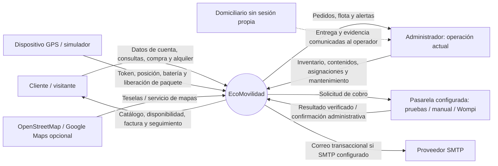

Fuentes: [README.md:1](../../README.md), [src/lib/api/index.ts:1](../../src/lib/api/index.ts), [backend/app/modules/pagos/gateway.py:1](../../backend/app/modules/pagos/gateway.py), [backend/app/modules/domicilios/models.py:19](../../backend/app/modules/domicilios/models.py)


### Casos de uso: general

**Estado:** Implementado. Notación de casos de uso con actores rectangulares y óvalos; líneas de inclusión conceptuales, no dependencias de código.

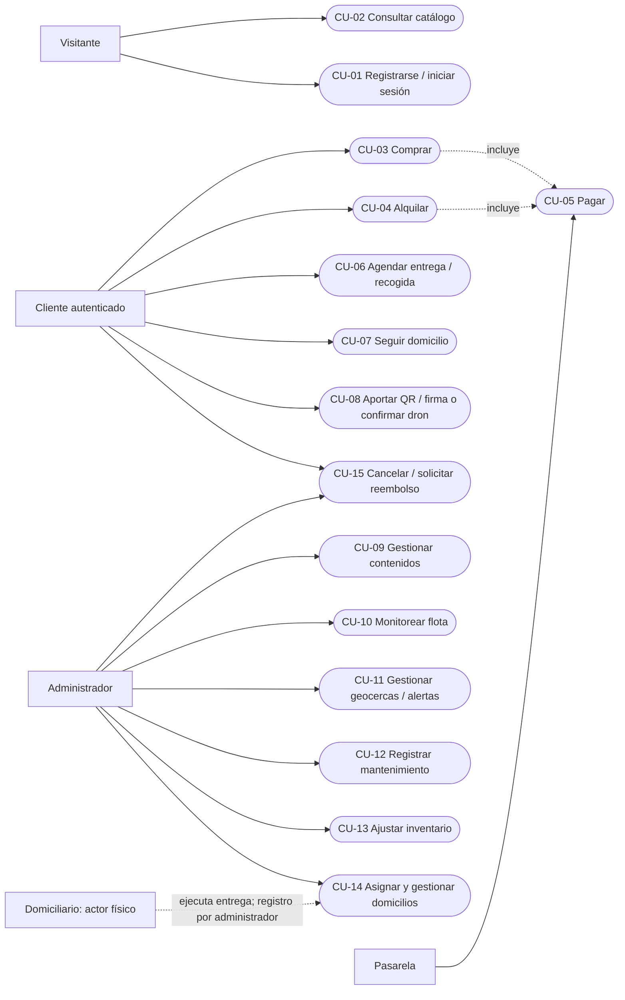

Fuentes: [REQUISITOS.md:107](../../REQUISITOS.md), [backend/app/api/deps.py:1](../../backend/app/api/deps.py)


### Casos de uso: cliente

**Estado:** Implementado. El visitante usa carrito local sin reserva de stock; el pago no se completa directamente en el navegador de EcoMovilidad.

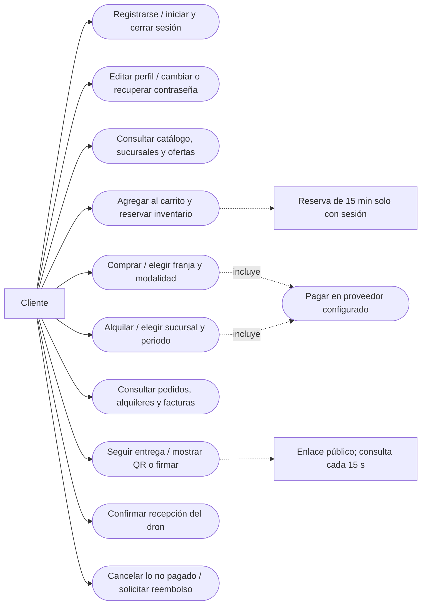

Fuentes: [backend/app/modules/autenticacion/router.py:1](../../backend/app/modules/autenticacion/router.py), [src/app/(sitio)/cuenta/page.tsx:1](../../src/app/(sitio)/cuenta/page.tsx), [backend/app/modules/inventario/reservations.py:1](../../backend/app/modules/inventario/reservations.py)


### Casos de uso: operador

**Estado:** Implementado con rol administrador. Describe tareas operativas implementadas bajo users.is_admin. No existe autorización diferenciada para operador.

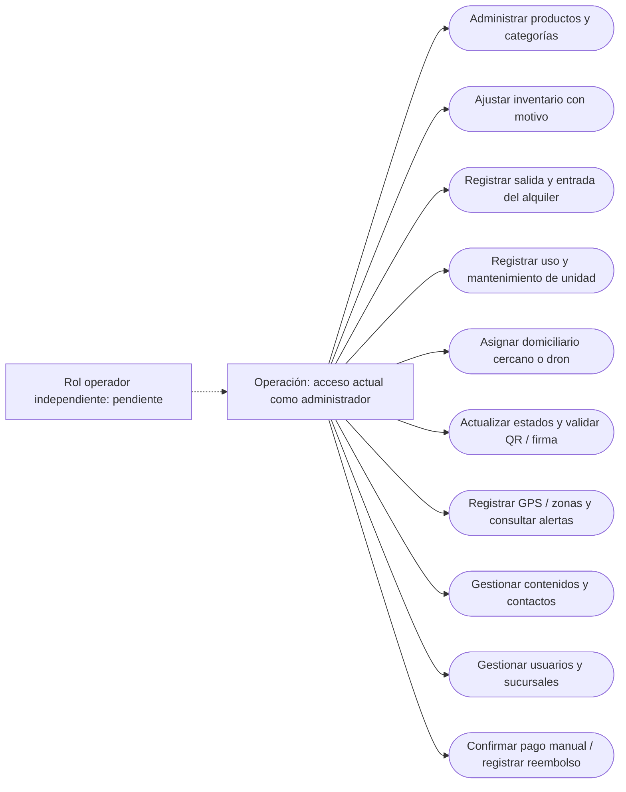

Fuentes: [backend/app/modules/admin/router.py:1](../../backend/app/modules/admin/router.py), [backend/app/modules/admin/rentals.py:1](../../backend/app/modules/admin/rentals.py), [backend/app/modules/domicilios/service.py:1](../../backend/app/modules/domicilios/service.py)


### Casos de uso: domiciliario

**Estado:** Proceso asistido; rol propio pendiente. Distingue actividad física y registro en el sistema; el token GPS no autentica al domiciliario como usuario.

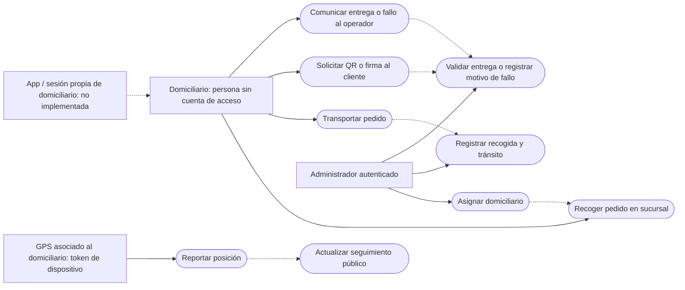

Fuentes: [backend/app/modules/domicilios/models.py:19](../../backend/app/modules/domicilios/models.py), [backend/app/modules/domicilios/service.py:204](../../backend/app/modules/domicilios/service.py), [backend/app/modules/telemetria/models.py:28](../../backend/app/modules/telemetria/models.py)


### DFD nivel 0

**Estado:** Implementado. DFD de contexto: no muestra almacenes internos. El pago manual sustituye el intercambio externo por la confirmación del administrador.

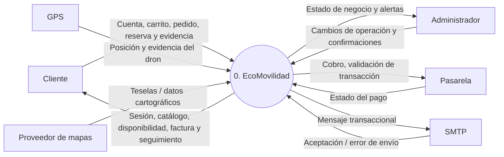

Fuentes: [backend/app/modules/pagos/service.py:1](../../backend/app/modules/pagos/service.py), [backend/app/modules/telemetria/router.py:1](../../backend/app/modules/telemetria/router.py), [src/features/branches/components/service-map.tsx:1](../../src/features/branches/components/service-map.tsx)


### DFD nivel 1

**Estado:** Implementado. Descomposición lógica balanceada con nivel 0; almacenes agrupan tablas de una única base PostgreSQL, no bases independientes.

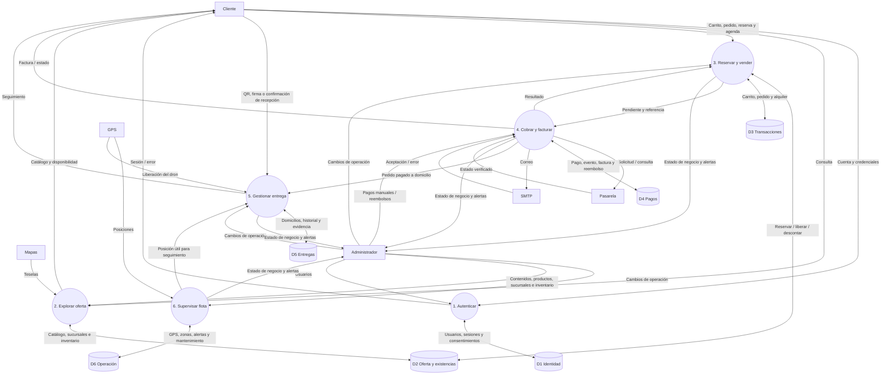

Fuentes: [backend/app/api/router.py:1](../../backend/app/api/router.py), [backend/app/modules/pedidos/service.py:1](../../backend/app/modules/pedidos/service.py), [backend/app/modules/domicilios/service.py:1](../../backend/app/modules/domicilios/service.py), [backend/app/modules/telemetria/service.py:1](../../backend/app/modules/telemetria/service.py)


## Arquitectura y diseño


### C4: contexto

**Estado:** Implementado. Semántica C4 expresada con flowchart: personas, sistema de interés y sistemas externos. No representa microservicios.

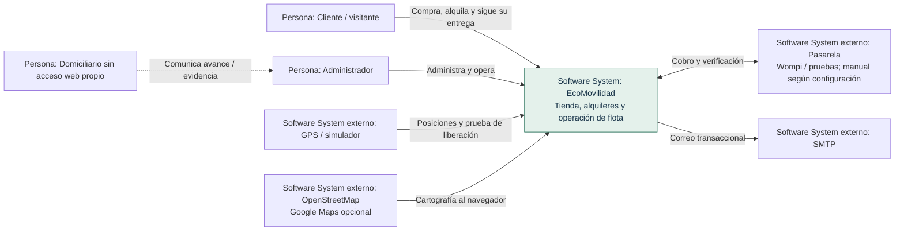

Fuentes: [README.md:1](../../README.md), [backend/app/modules/pagos/gateway.py:1](../../backend/app/modules/pagos/gateway.py), [backend/app/modules/telemetria/router.py:1](../../backend/app/modules/telemetria/router.py)


### C4: contenedores

**Estado:** Implementado. Vista en modo API_MODE=real. En mock, Next.js usa adaptadores de demostración. Worker pertenece al despliegue previsto; producción aún no publicada.

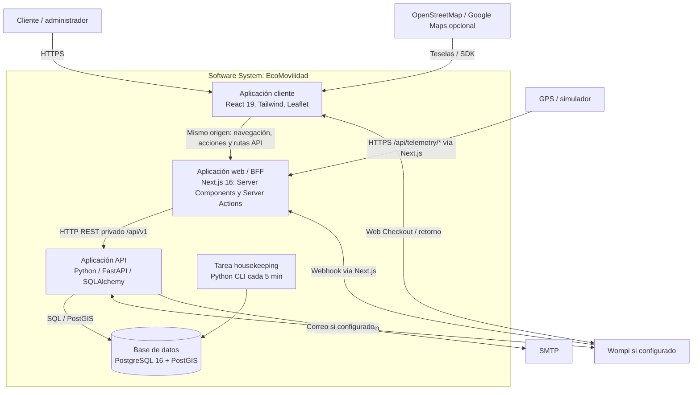

Fuentes: [src/lib/api/http-client.ts:1](../../src/lib/api/http-client.ts), [src/app/api/telemetry/positions/route.ts:1](../../src/app/api/telemetry/positions/route.ts), [src/app/api/webhooks/wompi/route.ts:1](../../src/app/api/webhooks/wompi/route.ts), [docker-compose.prod.yml:1](../../docker-compose.prod.yml)


### Diagrama de paquetes

**Estado:** Implementado. Paquetes reales; algunas reglas consultan SQLAlchemy directamente y no todos los módulos tienen repository.py.

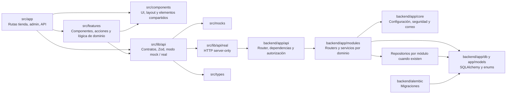

Fuentes: [src/lib/api/index.ts:1](../../src/lib/api/index.ts), [backend/app/api/router.py:1](../../backend/app/api/router.py), [backend/app/models/__init__.py:1](../../backend/app/models/__init__.py)


### Diagrama de componentes

**Estado:** Implementado. Componentes lógicos de un monolito modular; las flechas muestran dependencias principales, no procesos desplegados por separado.

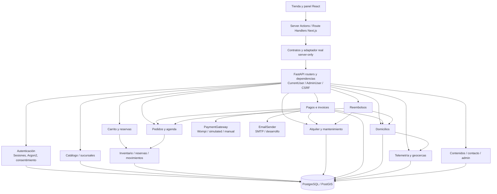

Fuentes: [backend/app/api/router.py:1](../../backend/app/api/router.py), [backend/app/modules/pagos/service.py:1](../../backend/app/modules/pagos/service.py), [backend/app/modules/domicilios/service.py:1](../../backend/app/modules/domicilios/service.py), [backend/app/modules/reembolsos/service.py:1](../../backend/app/modules/reembolsos/service.py)


### Diagrama de nodos / despliegue

**Estado:** Configuración de despliegue preparada. Topología declarada, aún no desplegada en producción. web, api y db no publican puertos al host. No hay réplicas ni clúster.

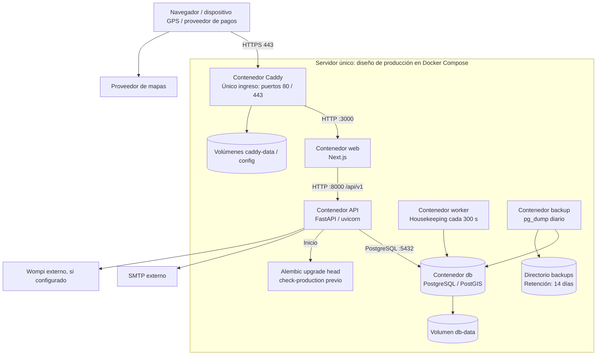

Fuentes: [docker-compose.prod.yml:1](../../docker-compose.prod.yml), [deploy/Caddyfile:1](../../deploy/Caddyfile), [docs/DESPLIEGUE.md:1](../../docs/DESPLIEGUE.md)


## Estructurales


### Diagrama de clases persistentes

**Estado:** Implementado. Todas las clases ORM con tabla propia: atributos persistentes y asociaciones por FK. No se inventan métodos de negocio en entidades; los servicios son funciones. created_at y updated_at comunes se omiten aquí y aparecen en el DER.

```mermaid
classDiagram
    accTitle: Diagrama de clases persistentes
    accDescr: Todas las clases ORM con tabla propia: atributos persistentes y asociaciones por FK. No se inventan métodos de negocio en entidades; los servicios son funciones. created_at y updated_at comunes se omiten aquí y aparecen en el DER.
direction LR
class RentalRate {
  <<SQLAlchemy>>
  +uuid id
  +uuid product_id
  +str unit
  +int price
}
class RentalUnit {
  <<SQLAlchemy>>
  +uuid id
  +uuid product_id
  +uuid branch_id
  +str code
  +str status
  +bool is_demo
  +str usage_unit
  +Decimal usage_value
  +int service_threshold
  +int service_interval_days
  +datetime last_service_at
}
class MaintenanceLog {
  <<SQLAlchemy>>
  +uuid id
  +uuid unit_id
  +str kind
  +Decimal usage_delta
  +Decimal usage_after
  +str note
  +uuid user_id
}
class Rental {
  <<SQLAlchemy>>
  +uuid id
  +uuid user_id
  +uuid product_id
  +uuid branch_id
  +uuid rental_unit_id
  +datetime start_at
  +datetime end_at
  +tstzrange period
  +str status
  +int price
  +datetime payment_expires_at
  +str contact_name
  +str contact_email
  +str contact_phone
  +str document_type
  +str document_number
  +datetime checked_out_at
  +uuid checked_out_by
  +datetime returned_at
  +uuid returned_by
  +Decimal return_usage
}
class User {
  <<SQLAlchemy>>
  +uuid id
  +str email
  +str password_hash
  +str first_name
  +str last_name
  +str phone
  +str document_number
  +bool is_active
  +bool is_admin
}
class UserSession {
  <<SQLAlchemy>>
  +uuid id
  +uuid user_id
  +str token_hash
  +str csrf_token_hash
  +datetime expires_at
}
class PasswordResetToken {
  <<SQLAlchemy>>
  +uuid id
  +uuid user_id
  +str token_hash
  +datetime expires_at
  +datetime used_at
}
class LoginAttempt {
  <<SQLAlchemy>>
  +uuid id
  +str email_hash
  +str ip_address
  +bool succeeded
}
class ConsentRecord {
  <<SQLAlchemy>>
  +uuid id
  +uuid user_id
  +str purpose
  +str policy_version
  +uuid order_id
  +uuid rental_id
  +datetime accepted_at
}
class Cart {
  <<SQLAlchemy>>
  +uuid id
  +uuid user_id
  +str status
}
class CartItem {
  <<SQLAlchemy>>
  +uuid id
  +uuid cart_id
  +uuid product_id
  +int quantity
  +int unit_price
}
class Category {
  <<SQLAlchemy>>
  +uuid id
  +str name
  +str slug
  +str description
}
class Product {
  <<SQLAlchemy>>
  +uuid id
  +uuid category_id
  +str name
  +str slug
  +str sku
  +str short_description
  +str description
  +str brand
  +int price
  +int compare_at_price
  +json specifications
  +json highlights
  +str image_url
  +bool is_featured
  +bool is_active
}
class ContactMessage {
  <<SQLAlchemy>>
  +uuid id
  +str full_name
  +str email
  +str phone
  +str topic
  +str message
  +str status
  +str policy_version
  +str ip_hash
}
class ValueProposition {
  <<SQLAlchemy>>
  +uuid id
  +str title
  +str description
  +str icon
  +int position
  +bool is_active
}
class Banner {
  <<SQLAlchemy>>
  +uuid id
  +str title
  +str description
  +str cta_label
  +str cta_href
  +datetime starts_at
  +datetime ends_at
  +bool is_active
}
class NewsItem {
  <<SQLAlchemy>>
  +uuid id
  +str slug
  +str title
  +str excerpt
  +datetime published_at
  +bool is_published
}
class Courier {
  <<SQLAlchemy>>
  +uuid id
  +str name
  +str phone
  +bool is_active
}
class Delivery {
  <<SQLAlchemy>>
  +uuid id
  +uuid order_id
  +uuid courier_id
  +str status
  +str tracking_token
  +str confirmation_code
  +str proof_method
  +str signer_name
  +str signature_image
  +str failure_reason
  +datetime delivered_at
  +str carrier
  +uuid drone_device_id
  +Decimal destination_latitude
  +Decimal destination_longitude
  +Decimal drop_latitude
  +Decimal drop_longitude
  +int drop_distance_m
  +datetime dropped_at
  +datetime customer_confirmed_at
}
class DeliveryEvent {
  <<SQLAlchemy>>
  +uuid id
  +uuid delivery_id
  +str status
  +str note
  +uuid user_id
}
class Inventory {
  <<SQLAlchemy>>
  +uuid id
  +uuid product_id
  +uuid branch_id
  +int available_quantity
  +int reserved_quantity
  +int total_quantity
}
class InventoryMovement {
  <<SQLAlchemy>>
  +uuid id
  +uuid inventory_id
  +str kind
  +int quantity
  +int balance_after
  +str reason
  +uuid order_id
  +uuid user_id
}
class CartReservation {
  <<SQLAlchemy>>
  +uuid id
  +uuid cart_item_id
  +uuid inventory_id
  +int quantity
  +datetime expires_at
}
class Payment {
  <<SQLAlchemy>>
  +uuid id
  +uuid user_id
  +uuid order_id
  +uuid rental_id
  +str provider
  +str reference
  +int amount_in_cents
  +str currency
  +str status
  +str provider_transaction_id
  +str payment_method_type
  +str status_message
  +bool requires_refund
  +datetime approved_at
}
class PaymentEvent {
  <<SQLAlchemy>>
  +uuid id
  +str checksum
  +str event
  +str transaction_id
  +str status
  +json payload
  +datetime received_at
}
class Invoice {
  <<SQLAlchemy>>
  +uuid id
  +int number
  +str prefix
  +uuid payment_id
  +uuid order_id
  +uuid rental_id
  +uuid user_id
  +str buyer_name
  +str buyer_document_type
  +str buyer_document_number
  +str buyer_email
  +int subtotal
  +int vat
  +int total
  +bytes pdf
  +str xml
  +datetime issued_at
}
class RefundRequest {
  <<SQLAlchemy>>
  +uuid id
  +uuid user_id
  +uuid order_id
  +uuid rental_id
  +str reason
  +str status
  +datetime resolved_at
}
class Order {
  <<SQLAlchemy>>
  +uuid id
  +uuid user_id
  +str status
  +int subtotal
  +int shipping_cost
  +int total
  +uuid branch_id
  +str fulfillment_method
  +str delivery_address
  +str delivery_city
  +date scheduled_date
  +str time_slot
  +str payment_method
  +datetime payment_expires_at
  +datetime stock_settled_at
  +str contact_name
  +str contact_email
  +str contact_phone
  +str document_type
  +str document_number
}
class OrderItem {
  <<SQLAlchemy>>
  +uuid id
  +uuid order_id
  +uuid product_id
  +int quantity
  +int unit_price
  +int subtotal
}
class Branch {
  <<SQLAlchemy>>
  +uuid id
  +str slug
  +str name
  +str address
  +str neighborhood
  +str city
  +str phone
  +Decimal latitude
  +Decimal longitude
  +geography location
  +json opening_hours
  +json services
  +int slot_capacity
  +bool is_demo
  +bool is_active
}
class GpsDevice {
  <<SQLAlchemy>>
  +uuid id
  +str code
  +str kind
  +str token_hash
  +uuid branch_id
  +uuid courier_id
  +uuid rental_unit_id
  +bool is_active
  +Decimal last_latitude
  +Decimal last_longitude
  +int last_battery_pct
  +datetime last_seen_at
}
class GpsPosition {
  <<SQLAlchemy>>
  +uuid id
  +uuid device_id
  +Decimal latitude
  +Decimal longitude
  +int battery_pct
  +datetime recorded_at
}
class Geofence {
  <<SQLAlchemy>>
  +uuid id
  +str name
  +Decimal latitude
  +Decimal longitude
  +int radius_m
  +bool is_active
  +geography location
}
class GeofenceAlert {
  <<SQLAlchemy>>
  +uuid id
  +uuid device_id
  +Decimal latitude
  +Decimal longitude
  +datetime opened_at
  +datetime closed_at
}
Product "1" <-- "0..*" RentalRate : product_id
Product "1" <-- "0..*" RentalUnit : product_id
Branch "1" <-- "0..*" RentalUnit : branch_id
RentalUnit "1" <-- "0..*" MaintenanceLog : unit_id
User "0..1" <-- "0..*" MaintenanceLog : user_id
User "1" <-- "0..*" Rental : user_id
Product "1" <-- "0..*" Rental : product_id
Branch "1" <-- "0..*" Rental : branch_id
RentalUnit "0..1" <-- "0..*" Rental : rental_unit_id
User "0..1" <-- "0..*" Rental : checked_out_by
User "0..1" <-- "0..*" Rental : returned_by
User "1" <-- "0..*" UserSession : user_id
User "1" <-- "0..*" PasswordResetToken : user_id
User "1" <-- "0..*" ConsentRecord : user_id
Order "0..1" <-- "0..*" ConsentRecord : order_id
Rental "0..1" <-- "0..*" ConsentRecord : rental_id
User "1" <-- "0..*" Cart : user_id
Cart "1" <-- "0..*" CartItem : cart_id
Product "1" <-- "0..*" CartItem : product_id
Category "1" <-- "0..*" Product : category_id
Order "1" <-- "0..1" Delivery : order_id
Courier "0..1" <-- "0..*" Delivery : courier_id
GpsDevice "0..1" <-- "0..*" Delivery : drone_device_id
Delivery "1" <-- "0..*" DeliveryEvent : delivery_id
User "0..1" <-- "0..*" DeliveryEvent : user_id
Product "1" <-- "0..*" Inventory : product_id
Branch "1" <-- "0..*" Inventory : branch_id
Inventory "1" <-- "0..*" InventoryMovement : inventory_id
Order "0..1" <-- "0..*" InventoryMovement : order_id
User "0..1" <-- "0..*" InventoryMovement : user_id
CartItem "1" <-- "0..*" CartReservation : cart_item_id
Inventory "1" <-- "0..*" CartReservation : inventory_id
User "1" <-- "0..*" Payment : user_id
Order "0..1" <-- "0..*" Payment : order_id
Rental "0..1" <-- "0..*" Payment : rental_id
Payment "1" <-- "0..1" Invoice : payment_id
Order "0..1" <-- "0..1" Invoice : order_id
Rental "0..1" <-- "0..1" Invoice : rental_id
User "1" <-- "0..*" Invoice : user_id
User "1" <-- "0..*" RefundRequest : user_id
Order "0..1" <-- "0..*" RefundRequest : order_id
Rental "0..1" <-- "0..*" RefundRequest : rental_id
User "1" <-- "0..*" Order : user_id
Branch "1" <-- "0..*" Order : branch_id
Order "1" <-- "0..*" OrderItem : order_id
Product "1" <-- "0..*" OrderItem : product_id
Branch "0..1" <-- "0..*" GpsDevice : branch_id
Courier "0..1" <-- "0..*" GpsDevice : courier_id
RentalUnit "0..1" <-- "0..*" GpsDevice : rental_unit_id
GpsDevice "1" <-- "0..*" GpsPosition : device_id
GpsDevice "1" <-- "0..*" GeofenceAlert : device_id
```

Fuentes: [backend/app/modules/alquiler/models.py:1](../../backend/app/modules/alquiler/models.py), [backend/app/modules/autenticacion/models.py:1](../../backend/app/modules/autenticacion/models.py), [backend/app/modules/autenticacion/security_records.py:1](../../backend/app/modules/autenticacion/security_records.py), [backend/app/modules/carrito/models.py:1](../../backend/app/modules/carrito/models.py), [backend/app/modules/catalogo/models.py:1](../../backend/app/modules/catalogo/models.py), [backend/app/modules/contacto/models.py:1](../../backend/app/modules/contacto/models.py), [backend/app/modules/contenidos/models.py:1](../../backend/app/modules/contenidos/models.py), [backend/app/modules/domicilios/models.py:1](../../backend/app/modules/domicilios/models.py), [backend/app/modules/inventario/models.py:1](../../backend/app/modules/inventario/models.py), [backend/app/modules/inventario/reservation_models.py:1](../../backend/app/modules/inventario/reservation_models.py), [backend/app/modules/pagos/models.py:1](../../backend/app/modules/pagos/models.py), [backend/app/modules/pedidos/models.py:1](../../backend/app/modules/pedidos/models.py), [backend/app/modules/sucursales/models.py:1](../../backend/app/modules/sucursales/models.py), [backend/app/modules/telemetria/models.py:1](../../backend/app/modules/telemetria/models.py)


### Diagrama de clases BCE

**Estado:** Implementado. BCE es una clasificación lógica: las cajas Control representan módulos Python con funciones, no clases Python declaradas. Boundary agrupa componente React y routers HTTP.

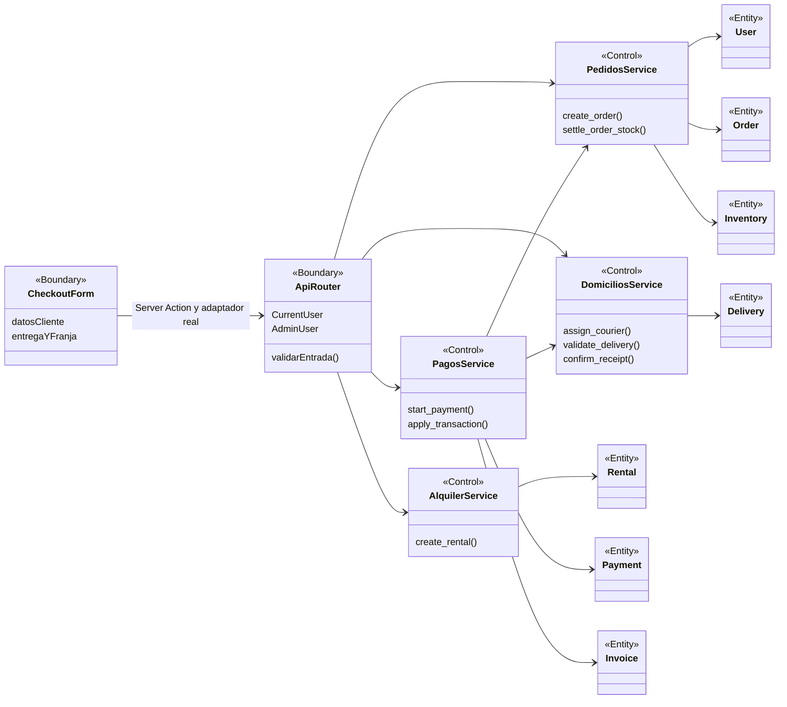

Fuentes: [src/features/checkout/components/checkout-form.tsx:1](../../src/features/checkout/components/checkout-form.tsx), [backend/app/modules/pedidos/service.py:1](../../backend/app/modules/pedidos/service.py), [backend/app/modules/pagos/service.py:1](../../backend/app/modules/pagos/service.py), [backend/app/modules/alquiler/service.py:1](../../backend/app/modules/alquiler/service.py), [backend/app/modules/domicilios/service.py:1](../../backend/app/modules/domicilios/service.py)


### Modelo de datos / DER completo

**Estado:** Implementado. DER derivado por AST de todos los modelos con __tablename__, incluidas tablas de seguridad. PK, FK y UK simples corresponden al código; índices parciales, CHECK y restricciones compuestas se explican en el diccionario de datos. Nullable es opcionalidad de columna, no del proceso de negocio.

```mermaid
erDiagram
    accTitle: Modelo de datos / DER completo
    accDescr: DER derivado por AST de todos los modelos con __tablename__, incluidas tablas de seguridad. PK, FK y UK simples corresponden al código; índices parciales, CHECK y restricciones compuestas se explican en el diccionario de datos. Nullable es opcionalidad de columna, no del proceso de negocio.
    direction LR
    rental_rates {
        uuid id PK
        uuid product_id FK
        str unit
        int price
    }
    rental_units {
        uuid id PK
        datetime created_at
        datetime updated_at
        uuid product_id FK
        uuid branch_id FK
        str code UK
        str status
        bool is_demo
        str usage_unit
        Decimal usage_value
        int service_threshold
        int service_interval_days
        datetime last_service_at
    }
    maintenance_logs {
        uuid id PK
        uuid unit_id FK
        str kind
        Decimal usage_delta "nullable"
        Decimal usage_after
        str note "nullable"
        uuid user_id FK "nullable"
        datetime created_at
    }
    rentals {
        uuid id PK
        datetime created_at
        datetime updated_at
        uuid user_id FK
        uuid product_id FK
        uuid branch_id FK
        uuid rental_unit_id FK "nullable"
        datetime start_at
        datetime end_at
        tstzrange period
        str status
        int price
        datetime payment_expires_at "nullable"
        str contact_name "nullable"
        str contact_email "nullable"
        str contact_phone "nullable"
        str document_type "nullable"
        str document_number "nullable"
        datetime checked_out_at "nullable"
        uuid checked_out_by FK "nullable"
        datetime returned_at "nullable"
        uuid returned_by FK "nullable"
        Decimal return_usage "nullable"
    }
    users {
        uuid id PK
        datetime created_at
        datetime updated_at
        str email UK
        str password_hash
        str first_name
        str last_name
        str phone
        str document_number "nullable"
        bool is_active
        bool is_admin
    }
    user_sessions {
        uuid id PK
        uuid user_id FK
        str token_hash UK
        str csrf_token_hash
        datetime expires_at
        datetime created_at
    }
    password_reset_tokens {
        uuid id PK
        uuid user_id FK
        str token_hash UK
        datetime expires_at
        datetime used_at "nullable"
        datetime created_at
    }
    login_attempts {
        uuid id PK
        str email_hash
        str ip_address
        bool succeeded
        datetime created_at
    }
    consent_records {
        uuid id PK
        uuid user_id FK
        str purpose
        str policy_version
        uuid order_id FK "nullable"
        uuid rental_id FK "nullable"
        datetime accepted_at
    }
    carts {
        uuid id PK
        datetime created_at
        datetime updated_at
        uuid user_id FK
        str status
    }
    cart_items {
        uuid id PK
        datetime created_at
        datetime updated_at
        uuid cart_id FK
        uuid product_id FK
        int quantity
        int unit_price
    }
    categories {
        uuid id PK
        str name UK
        str slug UK
        str description
    }
    products {
        uuid id PK
        datetime created_at
        datetime updated_at
        uuid category_id FK
        str name
        str slug UK
        str sku UK
        str short_description
        str description
        str brand
        int price
        int compare_at_price "nullable"
        json specifications
        json highlights
        str image_url "nullable"
        bool is_featured
        bool is_active
    }
    contact_messages {
        uuid id PK
        str full_name
        str email
        str phone "nullable"
        str topic
        str message
        str status
        str policy_version
        str ip_hash "nullable"
        datetime created_at
    }
    value_propositions {
        uuid id PK
        datetime created_at
        datetime updated_at
        str title
        str description
        str icon
        int position
        bool is_active
    }
    banners {
        uuid id PK
        datetime created_at
        datetime updated_at
        str title
        str description
        str cta_label
        str cta_href
        datetime starts_at
        datetime ends_at
        bool is_active
    }
    news_items {
        uuid id PK
        datetime created_at
        datetime updated_at
        str slug UK
        str title
        str excerpt
        datetime published_at
        bool is_published
    }
    couriers {
        uuid id PK
        datetime created_at
        datetime updated_at
        str name
        str phone
        bool is_active
    }
    deliveries {
        uuid id PK
        datetime created_at
        datetime updated_at
        uuid order_id FK
        uuid courier_id FK "nullable"
        str status
        str tracking_token UK
        str confirmation_code
        str proof_method "nullable"
        str signer_name "nullable"
        str signature_image "nullable"
        str failure_reason "nullable"
        datetime delivered_at "nullable"
        str carrier
        uuid drone_device_id FK "nullable"
        Decimal destination_latitude "nullable"
        Decimal destination_longitude "nullable"
        Decimal drop_latitude "nullable"
        Decimal drop_longitude "nullable"
        int drop_distance_m "nullable"
        datetime dropped_at "nullable"
        datetime customer_confirmed_at "nullable"
    }
    delivery_events {
        uuid id PK
        uuid delivery_id FK
        str status
        str note "nullable"
        uuid user_id FK "nullable"
        datetime created_at
    }
    inventory {
        uuid id PK
        uuid product_id FK
        uuid branch_id FK
        int available_quantity
        int reserved_quantity
        int total_quantity
        datetime updated_at
    }
    inventory_movements {
        uuid id PK
        uuid inventory_id FK
        str kind
        int quantity
        int balance_after
        str reason "nullable"
        uuid order_id FK "nullable"
        uuid user_id FK "nullable"
        datetime created_at
    }
    cart_reservations {
        uuid id PK
        uuid cart_item_id FK
        uuid inventory_id FK
        int quantity
        datetime expires_at
        datetime created_at
    }
    payments {
        uuid id PK
        datetime created_at
        datetime updated_at
        uuid user_id FK
        uuid order_id FK "nullable"
        uuid rental_id FK "nullable"
        str provider
        str reference UK
        int amount_in_cents
        str currency
        str status
        str provider_transaction_id UK "nullable"
        str payment_method_type "nullable"
        str status_message "nullable"
        bool requires_refund
        datetime approved_at "nullable"
    }
    payment_events {
        uuid id PK
        str checksum UK
        str event
        str transaction_id "nullable"
        str status "nullable"
        json payload
        datetime received_at
    }
    invoices {
        uuid id PK
        int number UK
        str prefix
        uuid payment_id FK
        uuid order_id FK "nullable"
        uuid rental_id FK "nullable"
        uuid user_id FK
        str buyer_name
        str buyer_document_type
        str buyer_document_number
        str buyer_email
        int subtotal
        int vat
        int total
        bytes pdf
        str xml
        datetime issued_at
    }
    refund_requests {
        uuid id PK
        uuid user_id FK
        uuid order_id FK "nullable"
        uuid rental_id FK "nullable"
        str reason
        str status
        datetime created_at
        datetime resolved_at "nullable"
    }
    orders {
        uuid id PK
        datetime created_at
        datetime updated_at
        uuid user_id FK
        str status
        int subtotal
        int shipping_cost
        int total
        uuid branch_id FK
        str fulfillment_method
        str delivery_address "nullable"
        str delivery_city "nullable"
        date scheduled_date
        str time_slot
        str payment_method "nullable"
        datetime payment_expires_at "nullable"
        datetime stock_settled_at "nullable"
        str contact_name
        str contact_email
        str contact_phone
        str document_type
        str document_number
    }
    order_items {
        uuid id PK
        uuid order_id FK
        uuid product_id FK
        int quantity
        int unit_price
        int subtotal
    }
    branches {
        uuid id PK
        datetime created_at
        datetime updated_at
        str slug UK
        str name
        str address
        str neighborhood
        str city
        str phone
        Decimal latitude
        Decimal longitude
        geography location
        json opening_hours
        json services
        int slot_capacity
        bool is_demo
        bool is_active
    }
    gps_devices {
        uuid id PK
        datetime created_at
        datetime updated_at
        str code UK
        str kind
        str token_hash UK
        uuid branch_id FK "nullable"
        uuid courier_id FK "nullable"
        uuid rental_unit_id FK "nullable"
        bool is_active
        Decimal last_latitude "nullable"
        Decimal last_longitude "nullable"
        int last_battery_pct "nullable"
        datetime last_seen_at "nullable"
    }
    gps_positions {
        uuid id PK
        uuid device_id FK
        Decimal latitude
        Decimal longitude
        int battery_pct "nullable"
        datetime recorded_at
    }
    geofences {
        uuid id PK
        datetime created_at
        datetime updated_at
        str name UK
        Decimal latitude
        Decimal longitude
        int radius_m
        bool is_active
        geography location
    }
    geofence_alerts {
        uuid id PK
        uuid device_id FK
        Decimal latitude
        Decimal longitude
        datetime opened_at
        datetime closed_at "nullable"
    }
    products ||--o{ rental_rates : "product_id"
    products ||--o{ rental_units : "product_id"
    branches ||--o{ rental_units : "branch_id"
    rental_units ||--o{ maintenance_logs : "unit_id"
    users |o--o{ maintenance_logs : "user_id"
    users ||--o{ rentals : "user_id"
    products ||--o{ rentals : "product_id"
    branches ||--o{ rentals : "branch_id"
    rental_units |o--o{ rentals : "rental_unit_id"
    users |o--o{ rentals : "checked_out_by"
    users |o--o{ rentals : "returned_by"
    users ||--o{ user_sessions : "user_id"
    users ||--o{ password_reset_tokens : "user_id"
    users ||--o{ consent_records : "user_id"
    orders |o--o{ consent_records : "order_id"
    rentals |o--o{ consent_records : "rental_id"
    users ||--o{ carts : "user_id"
    carts ||--o{ cart_items : "cart_id"
    products ||--o{ cart_items : "product_id"
    categories ||--o{ products : "category_id"
    orders ||--o| deliveries : "order_id"
    couriers |o--o{ deliveries : "courier_id"
    gps_devices |o--o{ deliveries : "drone_device_id"
    deliveries ||--o{ delivery_events : "delivery_id"
    users |o--o{ delivery_events : "user_id"
    products ||--o{ inventory : "product_id"
    branches ||--o{ inventory : "branch_id"
    inventory ||--o{ inventory_movements : "inventory_id"
    orders |o--o{ inventory_movements : "order_id"
    users |o--o{ inventory_movements : "user_id"
    cart_items ||--o{ cart_reservations : "cart_item_id"
    inventory ||--o{ cart_reservations : "inventory_id"
    users ||--o{ payments : "user_id"
    orders |o--o{ payments : "order_id"
    rentals |o--o{ payments : "rental_id"
    payments ||--o| invoices : "payment_id"
    orders |o--o| invoices : "order_id"
    rentals |o--o| invoices : "rental_id"
    users ||--o{ invoices : "user_id"
    users ||--o{ refund_requests : "user_id"
    orders |o--o{ refund_requests : "order_id"
    rentals |o--o{ refund_requests : "rental_id"
    users ||--o{ orders : "user_id"
    branches ||--o{ orders : "branch_id"
    orders ||--o{ order_items : "order_id"
    products ||--o{ order_items : "product_id"
    branches |o--o{ gps_devices : "branch_id"
    couriers |o--o{ gps_devices : "courier_id"
    rental_units |o--o{ gps_devices : "rental_unit_id"
    gps_devices ||--o{ gps_positions : "device_id"
    gps_devices ||--o{ geofence_alerts : "device_id"
```

Fuentes: [backend/app/modules/alquiler/models.py:1](../../backend/app/modules/alquiler/models.py), [backend/app/modules/autenticacion/models.py:1](../../backend/app/modules/autenticacion/models.py), [backend/app/modules/autenticacion/security_records.py:1](../../backend/app/modules/autenticacion/security_records.py), [backend/app/modules/carrito/models.py:1](../../backend/app/modules/carrito/models.py), [backend/app/modules/catalogo/models.py:1](../../backend/app/modules/catalogo/models.py), [backend/app/modules/contacto/models.py:1](../../backend/app/modules/contacto/models.py), [backend/app/modules/contenidos/models.py:1](../../backend/app/modules/contenidos/models.py), [backend/app/modules/domicilios/models.py:1](../../backend/app/modules/domicilios/models.py), [backend/app/modules/inventario/models.py:1](../../backend/app/modules/inventario/models.py), [backend/app/modules/inventario/reservation_models.py:1](../../backend/app/modules/inventario/reservation_models.py), [backend/app/modules/pagos/models.py:1](../../backend/app/modules/pagos/models.py), [backend/app/modules/pedidos/models.py:1](../../backend/app/modules/pedidos/models.py), [backend/app/modules/sucursales/models.py:1](../../backend/app/modules/sucursales/models.py), [backend/app/modules/telemetria/models.py:1](../../backend/app/modules/telemetria/models.py)


## Comportamiento


### Secuencia: registro

**Estado:** Implementado. El registro inicia sesión; la política de datos debe aceptarse. No hay verificación de correo obligatoria en este flujo.

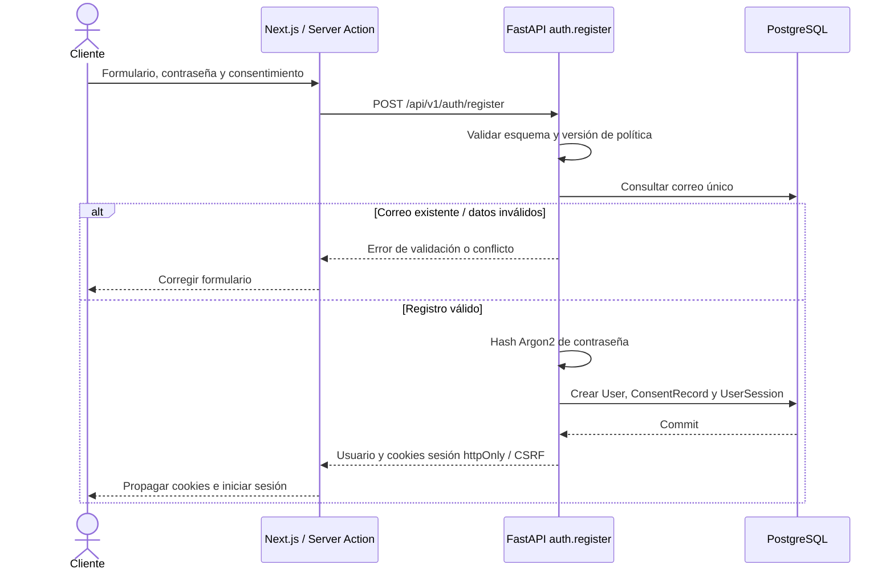

Fuentes: [backend/app/modules/autenticacion/router.py:47](../../backend/app/modules/autenticacion/router.py), [backend/app/modules/autenticacion/service.py:51](../../backend/app/modules/autenticacion/service.py), [src/features/auth/actions.ts:1](../../src/features/auth/actions.ts)


### Secuencia: inicio y cierre de sesión

**Estado:** Implementado. Límites: 5 fallos por cuenta y 30 por IP en 15 min. Cerrar sesión no cierra un alquiler ni devuelve un vehículo.

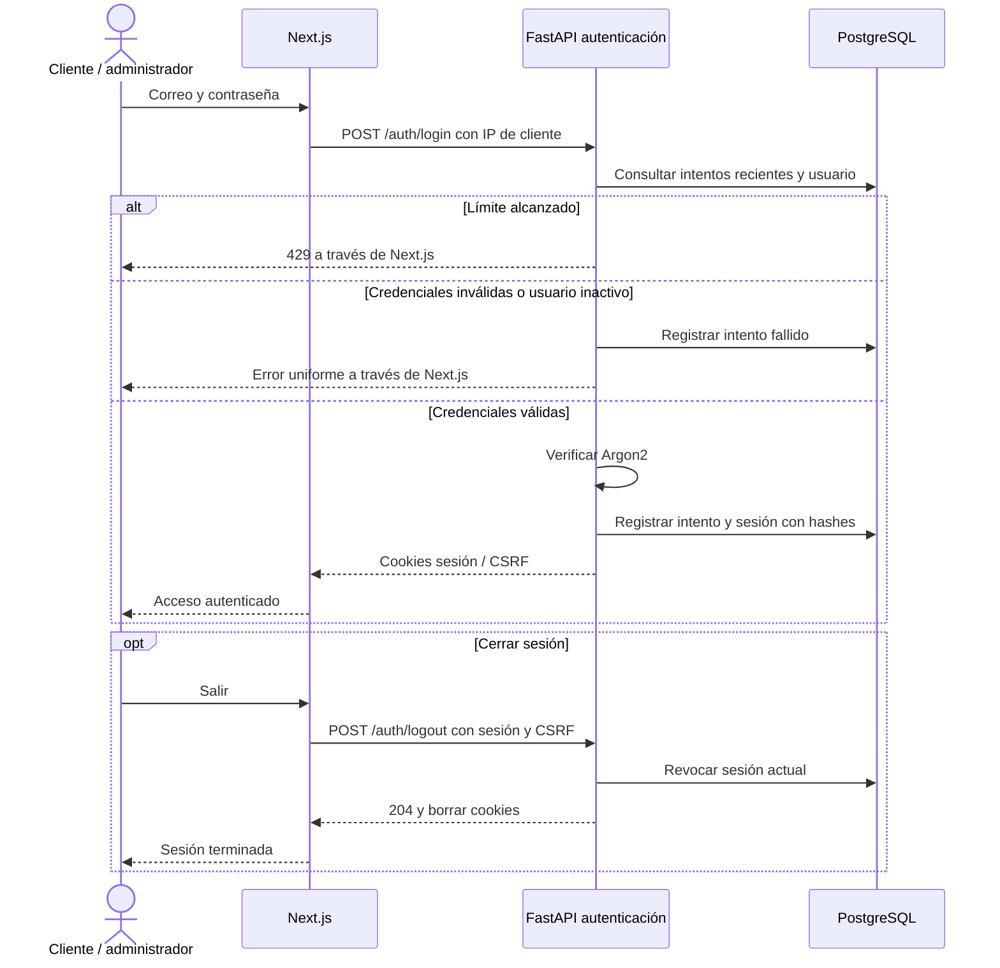

Fuentes: [backend/app/modules/autenticacion/router.py:54](../../backend/app/modules/autenticacion/router.py), [backend/app/modules/autenticacion/service.py:73](../../backend/app/modules/autenticacion/service.py), [backend/app/modules/autenticacion/login_guard.py:1](../../backend/app/modules/autenticacion/login_guard.py), [backend/app/api/deps.py:1](../../backend/app/api/deps.py)


### Secuencia: cierre del viaje / devolución

**Estado:** Implementado. Cierre de viaje se interpreta como devolución del alquiler: no hay cierre autónomo desde app del cliente ni medición de uso automática por GPS.

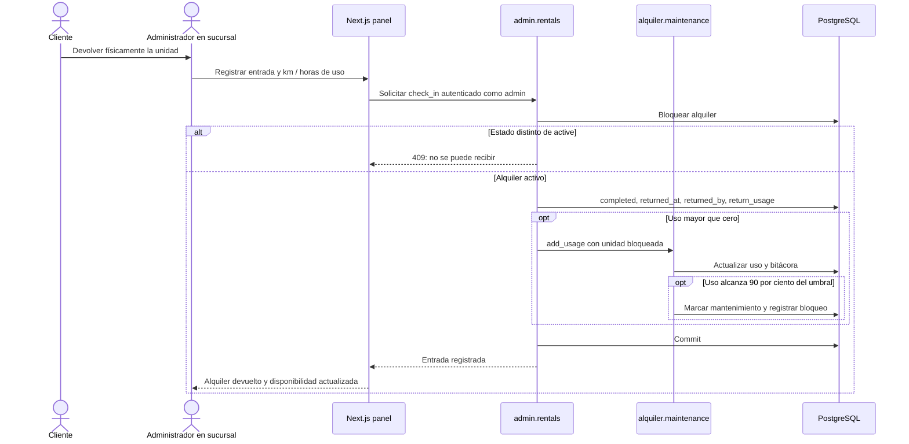

Fuentes: [backend/app/modules/admin/rentals.py:143](../../backend/app/modules/admin/rentals.py), [backend/app/modules/alquiler/maintenance.py:1](../../backend/app/modules/alquiler/maintenance.py)


### Secuencia: compra y pago

**Estado:** Implementado. Factura de venta PDF/XML sin validación DIAN. El checkout no acepta precios enviados por el cliente. El proveedor concreto depende de configuración.

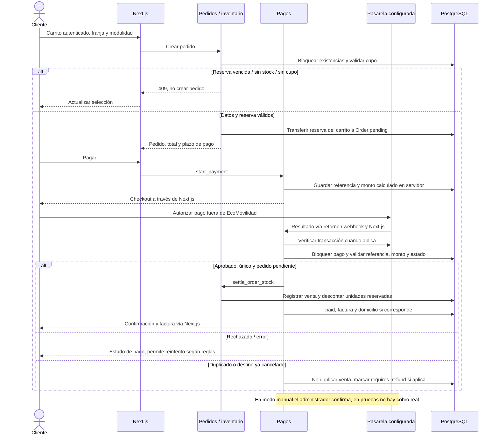

Fuentes: [backend/app/modules/pedidos/service.py:155](../../backend/app/modules/pedidos/service.py), [backend/app/modules/pagos/service.py:184](../../backend/app/modules/pagos/service.py)


### Secuencia: alquiler y pago

**Estado:** Implementado. La entrega del alquiler se hace en sucursal. Un pago tardío sobre alquiler no pendiente requiere revisión de reembolso.

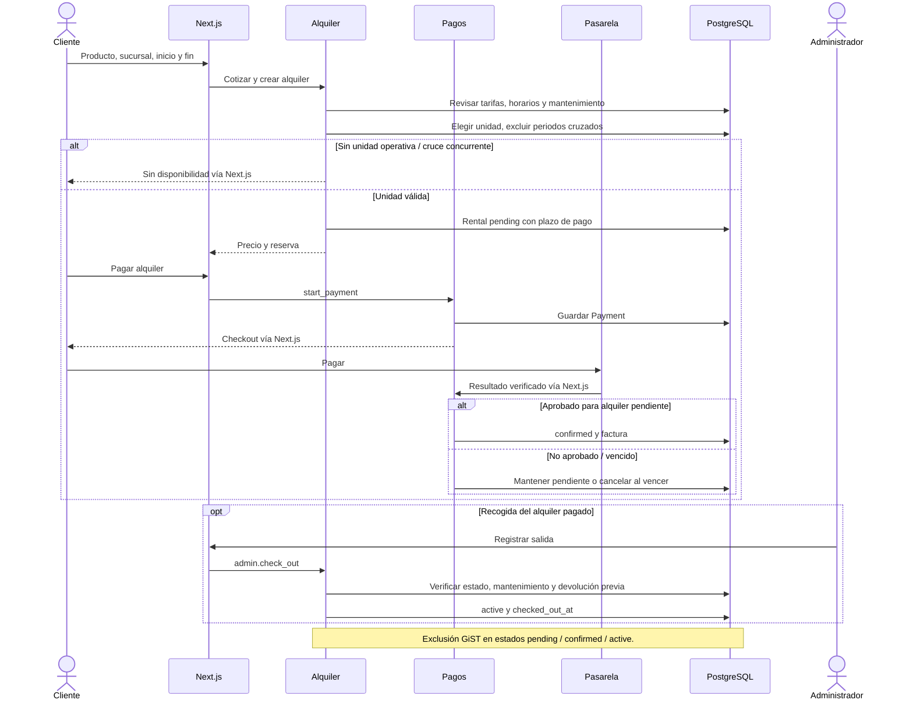

Fuentes: [backend/app/modules/alquiler/service.py:265](../../backend/app/modules/alquiler/service.py), [backend/app/modules/alquiler/models.py:36](../../backend/app/modules/alquiler/models.py), [backend/app/modules/pagos/service.py:172](../../backend/app/modules/pagos/service.py), [backend/app/modules/admin/rentals.py:129](../../backend/app/modules/admin/rentals.py)


### Secuencia: desbloqueo remoto propuesto

**Estado:** Propuesto; no implementado. Propuesta de diseño separada de la implementación. Hoy solo existe salida de sucursal por administrador; antes de implementar se requieren hardware, protocolo, auditoría, reintentos e idempotencia.

```mermaid
sequenceDiagram
    accTitle: Secuencia: desbloqueo remoto propuesto
    accDescr: Propuesta de diseño separada de la implementación. Hoy solo existe salida de sucursal por administrador; antes de implementar se requieren hardware, protocolo, auditoría, reintentos e idempotencia.
    actor C as Cliente
    participant UI as Interfaz futura
    participant API as Endpoint futuro de desbloqueo
    participant R as Alquiler / pago existentes
    participant IOT as Adaptador IoT futuro
    participant L as Cerradura futura
    Note over C,L: PROPUESTA: no existe endpoint, cerradura ni protocolo implementado.
    C->>UI: Solicitar desbloqueo de unidad asignada
    UI->>API: Solicitud autenticada con clave idempotente
    API->>R: Verificar dueño, pago, periodo y unidad operativa
    alt Sin autorización / unidad no elegible
      API-->>UI: Denegar sin enviar comando
    else Elegible
      API->>IOT: Emitir comando firmado de corta vigencia
      IOT->>L: Desbloquear con identificador único
      alt Confirmación física recibida
        L-->>IOT: ACK de cerradura
        IOT-->>API: Resultado verificable
        API-->>UI: Desbloqueo confirmado
      else Timeout / dispositivo sin conexión
        IOT-->>API: Resultado desconocido
        API-->>UI: No confirmar, conciliar estado y pedir asistencia
      end
    end
```

Fuentes: [backend/app/api/router.py:1](../../backend/app/api/router.py), [backend/app/modules/alquiler/models.py:1](../../backend/app/modules/alquiler/models.py), [backend/app/modules/admin/rentals.py:61](../../backend/app/modules/admin/rentals.py)


### Secuencia: alertas de vehículos

**Estado:** Implementado. El GPS puede reportar como máximo una posición por segundo. Sin zonas activas no se generan alertas por geocerca.

```mermaid
sequenceDiagram
    accTitle: Secuencia: alertas de vehículos
    accDescr: El GPS puede reportar como máximo una posición por segundo. Sin zonas activas no se generan alertas por geocerca.
    participant G as GPS / simulador
    participant N as Next.js route handler
    participant T as Telemetría
    participant D as PostgreSQL / PostGIS
    actor A as Administrador
    G->>N: Posición, batería y token de dispositivo
    N->>T: Reenviar posición a FastAPI
    T->>D: Verificar hash de token, activo y bloqueo de dispositivo
    alt Token inválido / demasiado frecuente
      T-->>G: Error de autenticación o 429 vía Next.js
    else Reporte aceptado
      T->>D: Guardar GpsPosition y última posición
      T->>D: ST_DWithin contra geocercas activas
      alt Fuera de todas las zonas y sin alerta abierta
        T->>D: Crear GeofenceAlert
      else Dentro de alguna zona o sin zonas activas
        T->>D: Cerrar alerta abierta si existe
      else Sigue afuera con alerta abierta
        T->>D: Conservar alerta sin duplicar
      end
      T->>D: Commit
      T-->>G: ACK y outside_zone vía Next.js
    end
    loop Cada 3 segundos desde el panel
      A->>N: Consultar telemetría y alertas
      N->>T: Obtener snapshot
      T-->>A: Estado actual vía Next.js
    end
    Note over T,A: Sin aparatos reales: simulación identificada. No hay WebSockets ni avisos push.
```

Fuentes: [backend/app/modules/telemetria/service.py:76](../../backend/app/modules/telemetria/service.py), [src/features/operations/lib/use-telemetry.ts:1](../../src/features/operations/lib/use-telemetry.ts)


### Secuencia: entrega a domicilio

**Estado:** Implementado. Participante Domicilios resume acciones y API; todo navegador/GPS entra por Next.js. Tras 30 min se habilita cierre con evidencia; el diagrama no presupone un cierre autónomo por temporizador.

```mermaid
sequenceDiagram
    accTitle: Secuencia: entrega a domicilio
    accDescr: Participante Domicilios resume acciones y API; todo navegador/GPS entra por Next.js. Tras 30 min se habilita cierre con evidencia; el diagrama no presupone un cierre autónomo por temporizador.
    participant P as Pagos
    participant S as Domicilios
    participant D as PostgreSQL
    actor A as Administrador
    actor C as Cliente
    participant G as GPS del dron
    P->>S: Pedido pagado con modalidad domicilio
    S->>D: Crear Delivery creado, código y tracking_token
    A->>S: Asignar domiciliario o dron con destino
    S->>D: asignado e historial
    A->>S: Registrar en_recogida y en_transito
    S->>D: Eventos y estado validados
    loop Cada 15 segundos
      C->>S: Consultar enlace público vía Next.js
      S-->>C: Estado y posición permitida, sin datos personales
    end
    alt Domiciliario
      C->>A: Mostrar QR / código o firmar
      A->>S: Validar código o firma
      S->>D: entregado con prueba y Order completed
    else Dron
      G->>S: Reportar liberación vía Next.js con token
      S->>D: Validar tránsito, dispositivo y distancia menor o igual a 50 m
      alt Liberación válida
        S->>D: Guardar evidencia, sigue en_transito
        alt Cliente confirma recepción
          C->>S: Confirmar desde cuenta propia vía Next.js
          S->>D: entregado con prueba dron, pedido completed
        else Pasan 30 min sin confirmación ni fallo
          A->>S: Validar con evidencia dron
          S->>D: Comprobar plazo y cerrar entrega
        end
      else Destino incorrecto / evidencia inválida
        S-->>G: Rechazar evidencia, no entregar
      end
    end
    opt Fallo antes de completar
      A->>S: Registrar fallido con motivo
      S->>D: Evento, reprogramable a creado
    end
```

Fuentes: [backend/app/modules/domicilios/service.py:111](../../backend/app/modules/domicilios/service.py), [backend/app/modules/domicilios/service.py:359](../../backend/app/modules/domicilios/service.py), [backend/app/modules/domicilios/service.py:387](../../backend/app/modules/domicilios/service.py)


### Estados: reserva de alquiler

**Estado:** Implementado. Reserva de alquiler, no la reserva temporal del carrito. El carrito aparta 15 min y elimina la reserva al vencer o transferirla al pedido; no posee columna status equivalente.

```mermaid
stateDiagram-v2
    accTitle: Estados: reserva de alquiler
    accDescr: Reserva de alquiler, no la reserva temporal del carrito. El carrito aparta 15 min y elimina la reserva al vencer o transferirla al pedido; no posee columna status equivalente.
    [*] --> pending: Crear reserva válida
    pending --> confirmed: Pago aprobado y aplicado
    pending --> cancelled: Cancelación o vencimiento sin pago
    confirmed --> active: Administrador registra salida
    active --> completed: Administrador registra devolución
    confirmed --> cancelled: Reembolso registrado según reglas
    completed --> [*]
    cancelled --> [*]
    note right of pending
      Unidad ocupada en calendario en pending,
      confirmed y active; exclusión GiST.
    end note
    note right of confirmed
      No se cancela desde cambio de estado:
      requiere flujo de reembolso.
    end note
```

Fuentes: [backend/app/modules/alquiler/models.py:33](../../backend/app/modules/alquiler/models.py), [backend/app/modules/admin/rentals.py:23](../../backend/app/modules/admin/rentals.py), [backend/app/modules/reembolsos/service.py:1](../../backend/app/modules/reembolsos/service.py)


### Estados: vehículo

**Estado:** Implementado. Separa mantenimiento persistido de disponibilidad calculada. Revisión periódica por defecto: 90 días; drones se siembran con 60 días.

```mermaid
stateDiagram-v2
    accTitle: Estados: vehículo
    accDescr: Separa mantenimiento persistido de disponibilidad calculada. Revisión periódica por defecto: 90 días; drones se siembran con 60 días.
    [*] --> operativo: Alta de unidad
    operativo --> mantenimiento: Uso alcanza 90% o revisión vencida
    operativo --> mantenimiento: Cambio administrativo sin alquiler vigente
    mantenimiento --> operativo: Mantenimiento registrado y unidad apta
    operativo --> retirado: Administrador sin alquiler vigente
    mantenimiento --> retirado: Administrador sin alquiler vigente
    retirado --> operativo: Reactivar solo si uso y revisión permiten operar
    retirado --> mantenimiento: Cambio administrativo sin alquiler vigente
    note left of operativo
      Estado persistido: operativo.
      Estar reservado o afuera se deriva
      de Rental; no son valores de status.
    end note
    note right of mantenimiento
      Retorno a operativo exige uso menor
      al 90% y revisión no vencida.
      El mantenimiento reinicia el uso.
    end note
```

Fuentes: [backend/app/models/enums.py:94](../../backend/app/models/enums.py), [backend/app/modules/alquiler/maintenance.py:1](../../backend/app/modules/alquiler/maintenance.py), [backend/app/modules/admin/rentals.py:253](../../backend/app/modules/admin/rentals.py)


### Estados: entrega

**Estado:** Implementado. Entregado es terminal; se alcanza mediante validación, no mediante un cambio de estado arbitrario.

```mermaid
stateDiagram-v2
    accTitle: Estados: entrega
    accDescr: Entregado es terminal; se alcanza mediante validación, no mediante un cambio de estado arbitrario.
    [*] --> creado: Pedido pagado con domicilio
    creado --> asignado: Asignar domiciliario o dron
    asignado --> asignado: Reasignar responsable
    asignado --> en_recogida: Registrar recogida
    en_recogida --> en_transito: Registrar salida
    en_transito --> entregado: QR o firma válidos
    en_transito --> entregado: Dron liberó y cliente confirma
    en_transito --> entregado: Evidencia dron y plazo de 30 min cumplido
    creado --> fallido: Motivo de fallo / reembolso
    asignado --> fallido: Motivo de fallo / reembolso
    en_recogida --> fallido: Motivo de fallo / reembolso
    en_transito --> fallido: Motivo de fallo
    fallido --> creado: Reprogramar pedido no cancelado
    entregado --> [*]
    note right of en_transito
      Soltar paquete con dron no cambia el estado.
      La evidencia se guarda en dropped_at.
      Entregado siempre exige prueba.
    end note
```

Fuentes: [backend/app/modules/domicilios/service.py:55](../../backend/app/modules/domicilios/service.py), [backend/app/modules/domicilios/service.py:359](../../backend/app/modules/domicilios/service.py), [backend/app/modules/domicilios/models.py:29](../../backend/app/modules/domicilios/models.py)


## Gestión


### Matriz de riesgos

**Estado:** Evaluación propuesta. Evaluación cualitativa propuesta para revisión del equipo, no estadística observada. Las posiciones se separan ligeramente por legibilidad; la tabla P x I es la valoración exacta.

```mermaid
quadrantChart
    accTitle: Matriz de riesgos
    accDescr: Evaluación cualitativa propuesta para revisión del equipo, no estadística observada. Las posiciones se separan ligeramente por legibilidad; la tabla P x I es la valoración exacta.
    title Valoración inicial propuesta, no medición de incidentes
    x-axis Probabilidad baja --> Probabilidad alta
    y-axis Impacto bajo --> Impacto alto
    quadrant-1 Mitigar prioritariamente
    quadrant-2 Proteger y ensayar recuperación
    quadrant-3 Vigilar
    quadrant-4 Reducir frecuencia
    R1 Pago duplicado: [0.55, 0.76]
    R2 Doble reserva: [0.24, 0.96]
    R3 GPS ausente: [0.75, 0.55]
    R4 Acceso indebido: [0.32, 0.88]
    R5 Perdida BD: [0.36, 0.98]
    R6 Entrega incorrecta: [0.64, 0.69]
    R7 Mantenimiento: [0.28, 0.74]
    R8 Servidor unico: [0.48, 0.81]
    R9 Integraciones: [0.86, 0.48]
    R10 Factura DIAN: [0.61, 0.92]
```

Fuentes: [README.md:1](../../README.md), [backend/app/api/deps.py:1](../../backend/app/api/deps.py), [backend/app/modules/alquiler/maintenance.py:1](../../backend/app/modules/alquiler/maintenance.py), [backend/app/modules/domicilios/service.py:1](../../backend/app/modules/domicilios/service.py), [backend/app/modules/inventario/reservations.py:1](../../backend/app/modules/inventario/reservations.py), [backend/app/modules/pagos/service.py:1](../../backend/app/modules/pagos/service.py), [backend/app/modules/telemetria/service.py:1](../../backend/app/modules/telemetria/service.py), [docker-compose.prod.yml:1](../../docker-compose.prod.yml)


## Anexos


### DER ampliado: identidad

**Estado:** Implementado. Vista parcial con atributos completos para facilitar lectura. Las relaciones entre dominios aparecen en el DER completo y en el diccionario de datos.

```mermaid
erDiagram
    accTitle: DER ampliado: identidad
    accDescr: Vista parcial con atributos completos para facilitar lectura. Las relaciones entre dominios aparecen en el DER completo y en el diccionario de datos.
    direction LR
    users {
        uuid id PK
        datetime created_at
        datetime updated_at
        str email UK
        str password_hash
        str first_name
        str last_name
        str phone
        str document_number "nullable"
        bool is_active
        bool is_admin
    }
    user_sessions {
        uuid id PK
        uuid user_id FK
        str token_hash UK
        str csrf_token_hash
        datetime expires_at
        datetime created_at
    }
    password_reset_tokens {
        uuid id PK
        uuid user_id FK
        str token_hash UK
        datetime expires_at
        datetime used_at "nullable"
        datetime created_at
    }
    login_attempts {
        uuid id PK
        str email_hash
        str ip_address
        bool succeeded
        datetime created_at
    }
    consent_records {
        uuid id PK
        uuid user_id FK
        str purpose
        str policy_version
        uuid order_id FK "nullable"
        uuid rental_id FK "nullable"
        datetime accepted_at
    }
    users ||--o{ user_sessions : "user_id"
    users ||--o{ password_reset_tokens : "user_id"
    users ||--o{ consent_records : "user_id"
```

Fuentes: [backend/app/modules/autenticacion/models.py:1](../../backend/app/modules/autenticacion/models.py), [backend/app/modules/autenticacion/security_records.py:1](../../backend/app/modules/autenticacion/security_records.py)


### DER ampliado: comercio

**Estado:** Implementado. Vista parcial con atributos completos para facilitar lectura. Las relaciones entre dominios aparecen en el DER completo y en el diccionario de datos.

```mermaid
erDiagram
    accTitle: DER ampliado: comercio
    accDescr: Vista parcial con atributos completos para facilitar lectura. Las relaciones entre dominios aparecen en el DER completo y en el diccionario de datos.
    direction LR
    users {
        uuid id PK
        datetime created_at
        datetime updated_at
        str email UK
        str password_hash
        str first_name
        str last_name
        str phone
        str document_number "nullable"
        bool is_active
        bool is_admin
    }
    categories {
        uuid id PK
        str name UK
        str slug UK
        str description
    }
    products {
        uuid id PK
        datetime created_at
        datetime updated_at
        uuid category_id FK
        str name
        str slug UK
        str sku UK
        str short_description
        str description
        str brand
        int price
        int compare_at_price "nullable"
        json specifications
        json highlights
        str image_url "nullable"
        bool is_featured
        bool is_active
    }
    branches {
        uuid id PK
        datetime created_at
        datetime updated_at
        str slug UK
        str name
        str address
        str neighborhood
        str city
        str phone
        Decimal latitude
        Decimal longitude
        geography location
        json opening_hours
        json services
        int slot_capacity
        bool is_demo
        bool is_active
    }
    inventory {
        uuid id PK
        uuid product_id FK
        uuid branch_id FK
        int available_quantity
        int reserved_quantity
        int total_quantity
        datetime updated_at
    }
    inventory_movements {
        uuid id PK
        uuid inventory_id FK
        str kind
        int quantity
        int balance_after
        str reason "nullable"
        uuid order_id FK "nullable"
        uuid user_id FK "nullable"
        datetime created_at
    }
    carts {
        uuid id PK
        datetime created_at
        datetime updated_at
        uuid user_id FK
        str status
    }
    cart_items {
        uuid id PK
        datetime created_at
        datetime updated_at
        uuid cart_id FK
        uuid product_id FK
        int quantity
        int unit_price
    }
    cart_reservations {
        uuid id PK
        uuid cart_item_id FK
        uuid inventory_id FK
        int quantity
        datetime expires_at
        datetime created_at
    }
    orders {
        uuid id PK
        datetime created_at
        datetime updated_at
        uuid user_id FK
        str status
        int subtotal
        int shipping_cost
        int total
        uuid branch_id FK
        str fulfillment_method
        str delivery_address "nullable"
        str delivery_city "nullable"
        date scheduled_date
        str time_slot
        str payment_method "nullable"
        datetime payment_expires_at "nullable"
        datetime stock_settled_at "nullable"
        str contact_name
        str contact_email
        str contact_phone
        str document_type
        str document_number
    }
    order_items {
        uuid id PK
        uuid order_id FK
        uuid product_id FK
        int quantity
        int unit_price
        int subtotal
    }
    categories ||--o{ products : "category_id"
    products ||--o{ inventory : "product_id"
    branches ||--o{ inventory : "branch_id"
    inventory ||--o{ inventory_movements : "inventory_id"
    orders |o--o{ inventory_movements : "order_id"
    users |o--o{ inventory_movements : "user_id"
    users ||--o{ carts : "user_id"
    carts ||--o{ cart_items : "cart_id"
    products ||--o{ cart_items : "product_id"
    cart_items ||--o{ cart_reservations : "cart_item_id"
    inventory ||--o{ cart_reservations : "inventory_id"
    users ||--o{ orders : "user_id"
    branches ||--o{ orders : "branch_id"
    orders ||--o{ order_items : "order_id"
    products ||--o{ order_items : "product_id"
```

Fuentes: [backend/app/modules/autenticacion/models.py:1](../../backend/app/modules/autenticacion/models.py), [backend/app/modules/carrito/models.py:1](../../backend/app/modules/carrito/models.py), [backend/app/modules/catalogo/models.py:1](../../backend/app/modules/catalogo/models.py), [backend/app/modules/inventario/models.py:1](../../backend/app/modules/inventario/models.py), [backend/app/modules/inventario/reservation_models.py:1](../../backend/app/modules/inventario/reservation_models.py), [backend/app/modules/pedidos/models.py:1](../../backend/app/modules/pedidos/models.py), [backend/app/modules/sucursales/models.py:1](../../backend/app/modules/sucursales/models.py)


### DER ampliado: alquiler

**Estado:** Implementado. Vista parcial con atributos completos para facilitar lectura. Las relaciones entre dominios aparecen en el DER completo y en el diccionario de datos.

```mermaid
erDiagram
    accTitle: DER ampliado: alquiler
    accDescr: Vista parcial con atributos completos para facilitar lectura. Las relaciones entre dominios aparecen en el DER completo y en el diccionario de datos.
    direction LR
    users {
        uuid id PK
        datetime created_at
        datetime updated_at
        str email UK
        str password_hash
        str first_name
        str last_name
        str phone
        str document_number "nullable"
        bool is_active
        bool is_admin
    }
    products {
        uuid id PK
        datetime created_at
        datetime updated_at
        uuid category_id FK
        str name
        str slug UK
        str sku UK
        str short_description
        str description
        str brand
        int price
        int compare_at_price "nullable"
        json specifications
        json highlights
        str image_url "nullable"
        bool is_featured
        bool is_active
    }
    branches {
        uuid id PK
        datetime created_at
        datetime updated_at
        str slug UK
        str name
        str address
        str neighborhood
        str city
        str phone
        Decimal latitude
        Decimal longitude
        geography location
        json opening_hours
        json services
        int slot_capacity
        bool is_demo
        bool is_active
    }
    rental_units {
        uuid id PK
        datetime created_at
        datetime updated_at
        uuid product_id FK
        uuid branch_id FK
        str code UK
        str status
        bool is_demo
        str usage_unit
        Decimal usage_value
        int service_threshold
        int service_interval_days
        datetime last_service_at
    }
    rental_rates {
        uuid id PK
        uuid product_id FK
        str unit
        int price
    }
    rentals {
        uuid id PK
        datetime created_at
        datetime updated_at
        uuid user_id FK
        uuid product_id FK
        uuid branch_id FK
        uuid rental_unit_id FK "nullable"
        datetime start_at
        datetime end_at
        tstzrange period
        str status
        int price
        datetime payment_expires_at "nullable"
        str contact_name "nullable"
        str contact_email "nullable"
        str contact_phone "nullable"
        str document_type "nullable"
        str document_number "nullable"
        datetime checked_out_at "nullable"
        uuid checked_out_by FK "nullable"
        datetime returned_at "nullable"
        uuid returned_by FK "nullable"
        Decimal return_usage "nullable"
    }
    maintenance_logs {
        uuid id PK
        uuid unit_id FK
        str kind
        Decimal usage_delta "nullable"
        Decimal usage_after
        str note "nullable"
        uuid user_id FK "nullable"
        datetime created_at
    }
    products ||--o{ rental_units : "product_id"
    branches ||--o{ rental_units : "branch_id"
    products ||--o{ rental_rates : "product_id"
    users ||--o{ rentals : "user_id"
    products ||--o{ rentals : "product_id"
    branches ||--o{ rentals : "branch_id"
    rental_units |o--o{ rentals : "rental_unit_id"
    users |o--o{ rentals : "checked_out_by"
    users |o--o{ rentals : "returned_by"
    rental_units ||--o{ maintenance_logs : "unit_id"
    users |o--o{ maintenance_logs : "user_id"
```

Fuentes: [backend/app/modules/alquiler/models.py:1](../../backend/app/modules/alquiler/models.py), [backend/app/modules/autenticacion/models.py:1](../../backend/app/modules/autenticacion/models.py), [backend/app/modules/catalogo/models.py:1](../../backend/app/modules/catalogo/models.py), [backend/app/modules/sucursales/models.py:1](../../backend/app/modules/sucursales/models.py)


### DER ampliado: pagos

**Estado:** Implementado. Vista parcial con atributos completos para facilitar lectura. Las relaciones entre dominios aparecen en el DER completo y en el diccionario de datos.

```mermaid
erDiagram
    accTitle: DER ampliado: pagos
    accDescr: Vista parcial con atributos completos para facilitar lectura. Las relaciones entre dominios aparecen en el DER completo y en el diccionario de datos.
    direction LR
    users {
        uuid id PK
        datetime created_at
        datetime updated_at
        str email UK
        str password_hash
        str first_name
        str last_name
        str phone
        str document_number "nullable"
        bool is_active
        bool is_admin
    }
    orders {
        uuid id PK
        datetime created_at
        datetime updated_at
        uuid user_id FK
        str status
        int subtotal
        int shipping_cost
        int total
        uuid branch_id FK
        str fulfillment_method
        str delivery_address "nullable"
        str delivery_city "nullable"
        date scheduled_date
        str time_slot
        str payment_method "nullable"
        datetime payment_expires_at "nullable"
        datetime stock_settled_at "nullable"
        str contact_name
        str contact_email
        str contact_phone
        str document_type
        str document_number
    }
    rentals {
        uuid id PK
        datetime created_at
        datetime updated_at
        uuid user_id FK
        uuid product_id FK
        uuid branch_id FK
        uuid rental_unit_id FK "nullable"
        datetime start_at
        datetime end_at
        tstzrange period
        str status
        int price
        datetime payment_expires_at "nullable"
        str contact_name "nullable"
        str contact_email "nullable"
        str contact_phone "nullable"
        str document_type "nullable"
        str document_number "nullable"
        datetime checked_out_at "nullable"
        uuid checked_out_by FK "nullable"
        datetime returned_at "nullable"
        uuid returned_by FK "nullable"
        Decimal return_usage "nullable"
    }
    payments {
        uuid id PK
        datetime created_at
        datetime updated_at
        uuid user_id FK
        uuid order_id FK "nullable"
        uuid rental_id FK "nullable"
        str provider
        str reference UK
        int amount_in_cents
        str currency
        str status
        str provider_transaction_id UK "nullable"
        str payment_method_type "nullable"
        str status_message "nullable"
        bool requires_refund
        datetime approved_at "nullable"
    }
    payment_events {
        uuid id PK
        str checksum UK
        str event
        str transaction_id "nullable"
        str status "nullable"
        json payload
        datetime received_at
    }
    invoices {
        uuid id PK
        int number UK
        str prefix
        uuid payment_id FK
        uuid order_id FK "nullable"
        uuid rental_id FK "nullable"
        uuid user_id FK
        str buyer_name
        str buyer_document_type
        str buyer_document_number
        str buyer_email
        int subtotal
        int vat
        int total
        bytes pdf
        str xml
        datetime issued_at
    }
    refund_requests {
        uuid id PK
        uuid user_id FK
        uuid order_id FK "nullable"
        uuid rental_id FK "nullable"
        str reason
        str status
        datetime created_at
        datetime resolved_at "nullable"
    }
    users ||--o{ orders : "user_id"
    users ||--o{ rentals : "user_id"
    users |o--o{ rentals : "checked_out_by"
    users |o--o{ rentals : "returned_by"
    users ||--o{ payments : "user_id"
    orders |o--o{ payments : "order_id"
    rentals |o--o{ payments : "rental_id"
    payments ||--o| invoices : "payment_id"
    orders |o--o| invoices : "order_id"
    rentals |o--o| invoices : "rental_id"
    users ||--o{ invoices : "user_id"
    users ||--o{ refund_requests : "user_id"
    orders |o--o{ refund_requests : "order_id"
    rentals |o--o{ refund_requests : "rental_id"
```

Fuentes: [backend/app/modules/alquiler/models.py:1](../../backend/app/modules/alquiler/models.py), [backend/app/modules/autenticacion/models.py:1](../../backend/app/modules/autenticacion/models.py), [backend/app/modules/pagos/models.py:1](../../backend/app/modules/pagos/models.py), [backend/app/modules/pedidos/models.py:1](../../backend/app/modules/pedidos/models.py)


### DER ampliado: logistica

**Estado:** Implementado. Vista parcial con atributos completos para facilitar lectura. Las relaciones entre dominios aparecen en el DER completo y en el diccionario de datos.

```mermaid
erDiagram
    accTitle: DER ampliado: logistica
    accDescr: Vista parcial con atributos completos para facilitar lectura. Las relaciones entre dominios aparecen en el DER completo y en el diccionario de datos.
    direction LR
    orders {
        uuid id PK
        datetime created_at
        datetime updated_at
        uuid user_id FK
        str status
        int subtotal
        int shipping_cost
        int total
        uuid branch_id FK
        str fulfillment_method
        str delivery_address "nullable"
        str delivery_city "nullable"
        date scheduled_date
        str time_slot
        str payment_method "nullable"
        datetime payment_expires_at "nullable"
        datetime stock_settled_at "nullable"
        str contact_name
        str contact_email
        str contact_phone
        str document_type
        str document_number
    }
    couriers {
        uuid id PK
        datetime created_at
        datetime updated_at
        str name
        str phone
        bool is_active
    }
    deliveries {
        uuid id PK
        datetime created_at
        datetime updated_at
        uuid order_id FK
        uuid courier_id FK "nullable"
        str status
        str tracking_token UK
        str confirmation_code
        str proof_method "nullable"
        str signer_name "nullable"
        str signature_image "nullable"
        str failure_reason "nullable"
        datetime delivered_at "nullable"
        str carrier
        uuid drone_device_id FK "nullable"
        Decimal destination_latitude "nullable"
        Decimal destination_longitude "nullable"
        Decimal drop_latitude "nullable"
        Decimal drop_longitude "nullable"
        int drop_distance_m "nullable"
        datetime dropped_at "nullable"
        datetime customer_confirmed_at "nullable"
    }
    delivery_events {
        uuid id PK
        uuid delivery_id FK
        str status
        str note "nullable"
        uuid user_id FK "nullable"
        datetime created_at
    }
    gps_devices {
        uuid id PK
        datetime created_at
        datetime updated_at
        str code UK
        str kind
        str token_hash UK
        uuid branch_id FK "nullable"
        uuid courier_id FK "nullable"
        uuid rental_unit_id FK "nullable"
        bool is_active
        Decimal last_latitude "nullable"
        Decimal last_longitude "nullable"
        int last_battery_pct "nullable"
        datetime last_seen_at "nullable"
    }
    gps_positions {
        uuid id PK
        uuid device_id FK
        Decimal latitude
        Decimal longitude
        int battery_pct "nullable"
        datetime recorded_at
    }
    geofences {
        uuid id PK
        datetime created_at
        datetime updated_at
        str name UK
        Decimal latitude
        Decimal longitude
        int radius_m
        bool is_active
        geography location
    }
    geofence_alerts {
        uuid id PK
        uuid device_id FK
        Decimal latitude
        Decimal longitude
        datetime opened_at
        datetime closed_at "nullable"
    }
    orders ||--o| deliveries : "order_id"
    couriers |o--o{ deliveries : "courier_id"
    gps_devices |o--o{ deliveries : "drone_device_id"
    deliveries ||--o{ delivery_events : "delivery_id"
    couriers |o--o{ gps_devices : "courier_id"
    gps_devices ||--o{ gps_positions : "device_id"
    gps_devices ||--o{ geofence_alerts : "device_id"
```

Fuentes: [backend/app/modules/domicilios/models.py:1](../../backend/app/modules/domicilios/models.py), [backend/app/modules/pedidos/models.py:1](../../backend/app/modules/pedidos/models.py), [backend/app/modules/telemetria/models.py:1](../../backend/app/modules/telemetria/models.py)


## Matriz de riesgos y tratamiento

Valoración inicial propuesta, pendiente de validación por el equipo. Escala ordinal P e I de 1 a 5; prioridad = P × I, no probabilidad estadística. Alta ≥ 12, media 6–11 y baja ≤ 5. Los responsables son funciones sugeridas, no asignaciones personales.

| Riesgo | P | I | P×I | Control existente | Acción propuesta | Responsable sugerido |
|---|---:|---:|---:|---|---|---|
| R1: Pago duplicado o tardío | 3 | 4 | 12 | Idempotencia, bloqueo de pago y requires_refund ya implementados. | Conciliar pasarela y reembolso manual. | Operación / pagos |
| R2: Sobreventa / doble reserva de unidad | 2 | 5 | 10 | Bloqueos de inventario y exclusión GiST de periodos. | Mantener pruebas concurrentes y revisar errores de integridad. | Backend |
| R3: GPS ausente o desactualizado | 4 | 3 | 12 | Marca de última posición y fallback de simulación. | Integrar y probar aparatos físicos; alertar por desconexión. | Operación |
| R4: Acceso indebido a datos personales | 2 | 5 | 10 | Sesiones httpOnly, CSRF, aislamiento por dueño y rol admin. | Revisión de accesos y política legal antes de producción. | Seguridad |
| R5: Pérdida de base de datos | 2 | 5 | 10 | Backup diario y retención 14 días declarados en Compose. | Desplegar, proteger copias externas y ensayar restauración. | Infraestructura |
| R6: Entrega incorrecta o sin evidencia | 3 | 4 | 12 | QR/firma; dron con destino, prueba GPS y confirmación. | Probar hardware y revisar reclamaciones con evidencia. | Logística |
| R7: Unidad usada sin mantenimiento | 2 | 4 | 8 | Bloqueo al 90% y por revisión vencida; bitácora. | Capacitar registro de uso y revisar umbrales. | Taller |
| R8: No disponibilidad del servidor único | 3 | 4 | 12 | Healthchecks y reinicio declarados, sin réplicas. | Medir disponibilidad y definir recuperación / redundancia. | Infraestructura |
| R9: Pasarela o correo sin configurar | 4 | 3 | 12 | Modos de prueba/manual y SMTP configurable. | Configurar servicios y probar llaves reales en sandbox. | Operación / integraciones |
| R10: Factura presentada como DIAN | 3 | 5 | 15 | La documentación diferencia factura de venta de DIAN. | Alinear textos comerciales y contratar proveedor si aplica. | Negocio / legal |